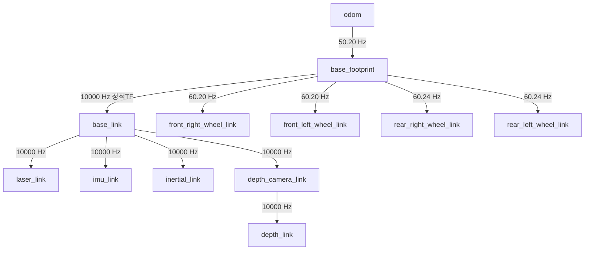

# Navigation2 자율주행 및 위치추정 분석 (Navigation)

본 문서는 AgileX LIMO Pro 모바일 로봇에 구축된 **Navigation2(Nav2)** 자율주행 스택의 소프트웨어 아키텍처, 좌표계(TF) 구조, 위치추정(AMCL), 코스트맵(Costmap), 그리고 실제 실차/시뮬레이션 주행 파이프라인을 분석하고 설명합니다.
본 문서에 수록된 수치와 설정값은 저장소의 실제 파라미터 파일([`nav2_explore_params.yaml`](../capstone_ws/src/limo_capstone/config/nav2_explore_params.yaml)) 및 실측 로그/계측 파일(`frames_2026-10-13_19.38.47.gv` 등)을 기준으로 작성되었습니다.

---

## 목차
- [1. 시스템 아키텍처 및 제어 흐름](#1-시스템-아키텍처-및-제어-흐름)
- [2. TF(좌표계) 트리 구조 및 실측 데이터 대조](#2-tf좌표계-트리-구조-및-실측-데이터-대조)
- [3. 점유격자지도 및 AMCL 위치추정 파라미터](#3-점유격자지도-및-amcl-위치추정-파라미터)
- [4. Costmap(코스트맵) 레이어 및 파라미터 구성](#4-costmap코스트맵-레이어-및-파라미터-구성)
- [5. 경로 계획(Planner) 및 경로 추종 제어기(Controller)](#5-경로-계획planner-및-경로-추종-제어기controller)
- [6. 실행 가이드 및 단계별 운용 절차](#6-실행-가이드-및-단계별-운용-절차)
- [7. 실차 주행 검증 결과 및 한계점](#7-실차-주행-검증-결과-및-한계점)

---

## 1. 시스템 아키텍처 및 제어 흐름

LIMO의 자율주행 시스템은 센서 측정값으로부터 최종 구동 명령(`/cmd_vel`)에 이르기까지 다음과 같은 단일화된 ROS 2 파이프라인으로 동작합니다.

```text
    [YDLiDAR T-mini Plus]       [LIMO 휠 엔코더 & IMU]
              │                            │
              ▼                            ▼
        /scan (LaserScan)          /wheel/odom, /imu
              │                            │
              │                            ▼
              │                  odom → base_link TF (50 Hz)
              │                            │
              │                            ▼
              │            base_link → base_footprint (정적 TF)
              │                            │
              ▼                            ▼
   ┌──────────────────────────────────────────────┐
   │         AMCL (Adaptive Monte Carlo Localization)│
   │  - 정적 점유격자지도 (/map) 로드                │
   │  - 초기 위치 (/initialpose) 수신 시 파티클 수렴│
   │  - map → odom TF 브로드캐스트 (10 Hz)          │
   └──────────────────────┬───────────────────────┘
                          │
                          ▼
   ┌──────────────────────────────────────────────┐
   │                 Nav2 Costmaps                │
   │  - Global Costmap: Static + Obstacle + Inflation│
   │  - Local Costmap: Rolling 3m×3m, Voxel + Inflation│
   └──────────────────────┬───────────────────────┘
                          │
                          ▼
   ┌──────────────────────────────────────────────┐
   │            Nav2 Planner & Controller         │
   │  - Global Planner (Navfn / Smac): 전역 경로 생성│
   │  - Local Controller (DWB / RPP): 궤적 추종   │
   └──────────────────────┬───────────────────────┘
                          │
                          ▼
                  /cmd_vel (Twist)
                          │
                          ▼
               [LIMO Base MCU 모터 구동]
```

---

## 2. TF(좌표계) 트리 구조 및 실측 데이터 대조

자율주행의 안정성은 로봇 좌표계 변환 트리의 무결성에 직결됩니다. LIMO Pro 시스템에서는 `tf2_tools view_frames`를 통해 좌표계 무결성을 실측하였으며, 실제 저장소 및 로그에서 확인되는 계측 결과는 다음과 같습니다.

### 2.1 실제 계측 파일 기반 TF 트리 구조 (`frames_2026-10-13_19.38.47.gv`)
로봇 온보드 환경에서 실제로 추출된 Graphviz 데이터에 따른 프레임 연결 및 브로드캐스트 주파수 실측치는 다음과 같습니다.



> [!NOTE]
> - **10월 13일 계측 (`frames_2026-10-13_19.38.47.gv`):** `odom → base_footprint` (50.20 Hz), `base_footprint → base_link` (정적 TF, 10,000 Hz), 4륜 링크(약 60.2 Hz), 센서 링크들(10,000 Hz)이 확인되었습니다.
> - **8주차 AMCL 구동 시 (10월 21일 보고서 기록):** AMCL 노드가 활성화되어 상위에 `map → odom` (약 10.36 Hz) 변환이 결합됨으로써 `map → odom → base_link → base_footprint`로 이어지는 전체 10개 프레임 체인이 단일 트리로 완성됨이 보고되었습니다.

### 2.2 `base_footprint` 정적 TF 추가 배경
- **문제:** LIMO 하드웨어 드라이버(`limo_driver.cpp`)는 `odom → base_link` 변환만 브로드캐스트하여, Nav2 Costmap2D가 필수로 요구하는 `base_footprint` 프레임이 누락됨.
- **해결:** [`capstone_ws/src/limo_capstone/launch/limo_nav2.launch.py`](../capstone_ws/src/limo_capstone/launch/limo_nav2.launch.py#L35-L42)에 `static_transform_publisher` 노드를 추가하여 `base_link → base_footprint` (0, 0, 0, 0, 0, 0) 항등 변환을 제공함 (Commit `7439841`).

---

## 3. 점유격자지도 및 AMCL 위치추정 파라미터

### 3.1 지도 로딩 및 수명주기(Lifecycle) 관리
Nav2의 `map_server`와 `amcl` 노드는 ROS 2 Managed Node(Lifecycle Node)입니다.
- **상태 전이:** `unconfigured` $\rightarrow$ `inactive` (configure 단계에서 YAML 및 PGM 파싱) $\rightarrow$ `active` (activate 단계에서 토픽 퍼블리셔 활성화).
- **QoS 특성:** `/map` 토픽은 `Transient Local` (Latched) 내구성으로 방출되므로, RViz2 구독자 또한 `Transient Local`로 일치시켜야 화면에 지도가 표출됩니다.

### 3.2 실제 설정 파일 파라미터 ([`nav2_explore_params.yaml`](../capstone_ws/src/limo_capstone/config/nav2_explore_params.yaml))
현재 저장소의 실제 AMCL 설정값은 다음과 같습니다:

```yaml
amcl:
  ros__parameters:
    use_sim_time: False
    alpha1: 0.2
    alpha2: 0.2
    alpha3: 0.2
    alpha4: 0.2
    alpha5: 0.2
    base_frame_id: "base_footprint"
    global_frame_id: "map"
    odom_frame_id: "odom"
    scan_topic: scan
    min_particles: 500
    max_particles: 2000
    update_min_d: 0.25        # 25cm 이동 시 파티클 갱신 (저장소 설정값)
    update_min_a: 0.20        # 약 11.5도(0.2 rad) 회전 시 파티클 갱신
    laser_min_range: -1.0     # 기본 최소 거리
    laser_max_range: 100.0    # 기본 최대 거리
    laser_model_type: "likelihood_field"
    robot_model_type: "nav2_amcl::DifferentialMotionModel"
```

> [!NOTE]
> 진도보고서 10주차 계획에 제안된 파라미터(`update_min_d: 0.10`, `update_min_a: 0.10`, `laser_min_range: 0.05`, `laser_max_range: 10.0`)는 좁은 복도에서의 빠른 위치 갱신을 위해 향후 적용을 검토 중인 튜닝 제안값이며, 현재 저장소의 기본 설정 파일에는 위의 표기된 값(`update_min_d: 0.25` 등)이 적용되어 있습니다.

---

## 4. Costmap(코스트맵) 레이어 및 파라미터 구성

Nav2는 충돌 회피와 주행 가능 공간을 판단하기 위해 전역(Global)과 지역(Local)의 2단계 2D Costmap을 유지합니다.

### 4.1 Global Costmap 실제 설정
- **프레임:** `global_frame: map`, `robot_base_frame: base_link`
- **해상도 및 반경:** `resolution: 0.05`, `robot_radius: 0.19`
- **레이어 구성:** `plugins: ["static_layer", "obstacle_layer", "inflation_layer"]`
  - `static_layer`: `map_server`에서 수신한 정적 점유격자지도 반영 (`map_subscribe_transient_local: True`).
  - `obstacle_layer`: 라이다 `/scan` 관측 데이터를 기반으로 장애물 등록(`marking: True`) 및 클리어링(`clearing: True`, `raytrace_max_range: 3.0`, `obstacle_max_range: 2.5`).
  - `track_unknown_space: true`: 미지의 영역을 장애물과 구분하여 탐색/경로 생성에 활용.

### 4.2 Local Costmap 실제 설정
- **프레임:** `global_frame: odom`, `robot_base_frame: base_link`
- **형태:** `rolling_window: true`, 크기 $3.0\,\text{m} \times 3.0\,\text{m}$, 해상도 $0.05\,\text{m}$
- **레이어 구성:** `plugins: ["voxel_layer", "inflation_layer"]`
  - `inflation_layer`: `cost_scaling_factor: 7.0`, `inflation_radius: 0.30` (LIMO Pro 차체 폭에 맞춘 슬림한 안전 마진 적용)
  - `voxel_layer`: 라이다 `/scan` 데이터를 3D Voxel 그리드(16 voxels, 높이 2.0m)로 누적하여 장애물 판단.

---

## 5. 경로 계획(Planner) 및 경로 추종 제어기(Controller)

### 5.1 Global Planner
- **기본 플러그인:** `nav2_navfn_planner/NavfnPlanner` (A* 및 Dijkstra 기반)
- **역할:** 정적 지도와 전역 코스트맵 상에서 현재 로봇 위치부터 2D Goal Pose까지의 최단 기하학적 경로를 생성.

### 5.2 Local Controller (실제 파일: `DWBLocalPlanner`)
- **실제 파라미터 ([`nav2_explore_params.yaml`](../capstone_ws/src/limo_capstone/config/nav2_explore_params.yaml)):**
  - 플러그인: `dwb_core::DWBLocalPlanner`
  - 속도 제한: `max_vel_x: 0.26 m/s`, `max_speed_xy: 0.26 m/s`, `max_vel_theta: 1.0 rad/s`
  - 도달 오차 허용치: `xy_goal_tolerance: 0.08 m`, `yaw_goal_tolerance: 0.25 rad`
  - 평가지표(Critics): `RotateToGoal`, `Oscillation`, `BaseObstacle`, `GoalAlign`, `PathAlign`, `PathDist`, `GoalDist`
- **시뮬레이션 전용 설정:**
  - Ackermann 조향 기구학을 반영하기 위해 시뮬레이션 환경에서는 `nav2_regulated_pure_pursuit_controller::RegulatedPurePursuitController`를 적용한 별도 설정([`nav2_sim_params.yaml`](../capstone_ws/src/limo_capstone/config/nav2_sim_params.yaml))을 분리 운용.

---

## 6. 실행 가이드 및 단계별 운용 절차

실제 LIMO Pro 로봇에서 정적 지도 기반 자율주행을 수행하는 표준 절차입니다.

### 1단계: 패키지 빌드 및 환경 로드
```bash
cd ~/school/2026-2/Capstone1_limo/capstone_ws
colcon build --symlink-install --packages-select limo_capstone
source install/setup.bash
```

### 2단계: LIMO 하드웨어 드라이버 구동
```bash
# 터미널 1: LIMO Base 드라이버 (시리얼 포트 명시)
ros2 launch limo_base limo_base.launch.py port_name:=ttyUSB1

# 터미널 2: YDLiDAR T-mini Plus 드라이버
ros2 launch ydlidar_ros2_driver ydlidar.launch.py
```

### 3단계: Nav2 스택 실행 (원하는 지도 지정)
```bash
# 터미널 3: Nav2 실행 (원하는 지도 파일 지정)
ros2 launch limo_capstone limo_nav2.launch.py \
  map:=$(ros2 pkg prefix limo_capstone)/share/limo_capstone/maps/demo_map.yaml \
  use_sim_time:=false
```

### 4단계: Lifecycle 노드 점검 및 활성화 (필요 시)
만약 RViz에서 `No map received`가 표시될 경우 수동 활성화:
```bash
ros2 lifecycle set /map_server configure && ros2 lifecycle set /map_server activate
ros2 lifecycle set /amcl configure && ros2 lifecycle set /amcl activate
```

### 5단계: RViz2 시각화 및 목표점 주행
1. 호스트 PC 또는 온보드 PC에서 `rviz2` 실행.
2. 상단 툴바의 **`2D Pose Estimate`**를 클릭하고 지도의 특징점에 맞추어 실제 로봇의 위치와 방향을 설정 $\rightarrow$ AMCL 파티클들이 로봇 주변에 수렴함을 확인.
3. 상단 툴바의 **`2D Goal Pose`**를 클릭하여 원하는 목적지 클릭 $\rightarrow$ 전역 경로 생성 및 LIMO 실차 주행 개시.

---

## 7. 실차 주행 검증 결과 및 한계점

### 7.1 검증 완료된 항목 (Verified)
- **정적 지도 기반 주행:** 연구실(`demo_map`) 및 미래관 3층 세미나실(`MC3F_room_map`)에서 목표점 지정 시 전역 경로 생성 및 목적지 도착 확인.
- **TF 무결성:** 전체 프레임 연결 및 고주파수 발행 확인.
- **QoS 및 Lifecycle 전이:** Map Server 및 AMCL 수명주기 활성화 및 토픽 수신 안정화.

### 7.2 한계점 및 향후 보완 과제 (Limitations & Next Steps)
1. **수동 초기 위치 의존성:** 현재는 주행 전 사용자가 RViz에서 `2D Pose Estimate`를 수동으로 입력해야 함 $\rightarrow$ 고정 위치 초기화 로직 개발 필요.
2. **동적 장애물 회피 실차 튜닝:** 정적 장애물 회피는 Local Costmap을 통해 작동하나, 보행자 출현 시 즉각 정지 및 우회 제어기는 추가 파라미터 최적화 필요.
3. **배터리 관리:** 전압 강하로 인한 USB 통신 단절을 방지하기 위해 배터리 3칸 이상에서만 주행 시험을 지속해야 함.
