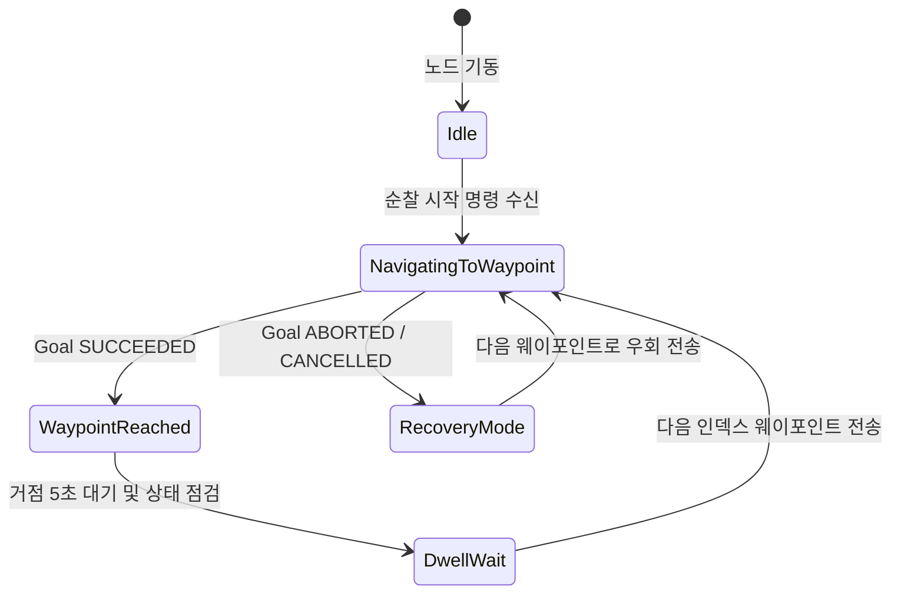

# 프로젝트 개발 상태 및 향후 로드맵 (Roadmap)

본 문서는 LIMO Pro를 이용한 실내 자율순찰 및 안내 시스템의 **현재 개발 구현 상태**를 객관적 근거에 기반하여 분류하고, 향후 완성해야 할 핵심 미완료 기능(동적 장애물 회피, 다중 웨이포인트 자율 순찰, 목적지 안내)의 상세 아키텍처 및 검증 계획을 정의합니다.

---

## 목차
- [1. 현재 구현 상태 매트릭스](#1-현재-구현-상태-매트릭스)
- [2. 미완료 핵심 기능 상세 설계](#2-미완료-핵심-기능-상세-설계)
  - [2.1 동적 장애물 회피 시스템](#21-동적-장애물-회피-시스템)
  - [2.2 ROS 2 Action 기반 다중 웨이포인트 순찰 시스템](#22-ros-2-action-기반-다중-웨이포인트-순찰-시스템)
  - [2.3 사용자 호출 기반 목적지 에스코트 안내 시스템](#23-사용자-호출-기반-목적지-에스코트-안내-시스템)
- [3. 시스템 신뢰성 및 하드웨어 안전 대책](#3-시스템-신뢰성-및-하드웨어-안전-대책)
- [4. 향후 주차별 실행 계획 (9~15주차)](#4-향후-주차별-실행-계획-915주차)

---

## 1. 현재 구현 상태 매트릭스

본 프로젝트에서는 증거 기반 엔지니어링 원칙에 따라 개발 항목을 다음 4단계로 엄격히 구분합니다.

| 구분 | 기능 / 모듈 | 구현 상태 | 검증 수준 | 근거 및 관련 파일 |
|---|---|:---:|:---:|---|
| **확인된 기능**<br>(Verified) | **LIMO Base 구동 및 오도메트리** | 완료 | 실차 확인 | `limo_base.launch.py port_name:=ttyUSB1`<br>`/wheel/odom`, `odom → base_link` (50 Hz) 확인 |
| | **YDLiDAR T-mini Plus 2D 라이다 연동** | 완료 | 실차 확인 | `ydlidar.launch.py`, QoS `BEST_EFFORT` 수신 확인 |
| | **SLAM 수동 맵핑 및 지도 저장** | 완료 | 실차 확인 | SLAM Toolbox, `demo_map`, `domi_map`, `MC_2F_10_07`, `MC_3F_10_15` (저장소) 및 `MC3F_room_map` (10/21 작업본) 취득 |
| | **`setup.py` 파일 필터링 빌드** | 완료 | 빌드/배포 확인 | `os.path.isfile(f)` 패치, 13개 맵 파일 자동 배포 (Commit `b46aba9`) |
| | **Nav2 필수 `base_footprint` TF 브로드캐스트** | 완료 | 실차 확인 | `static_transform_publisher` 추가, 10,000 Hz 발행 (Commit `7439841`) |
| | **10개 TF 프레임 무결성 계측** | 완료 | 실차 확인 | `tf2_tools view_frames` 온보드 실측(`frames_2026-10-13_19.38.47.gv`) 및 8주차 보고서 실측 기록 |
| | **Nav2 Map Server Lifecycle 관리 및 수신** | 완료 | 실차 확인 | Lifecycle 전환(`configure` $\rightarrow$ `activate`) 및 `Transient Local` QoS |
| | **정적 지도 기반 2D Goal Pose 자율주행** | 완료 | 실차 확인 | AMCL 초기위치 설정 후 DWB Controller 실차 주행 완주 |
| | **Explore Lite `middle` 전략 수정** | 완료 | 시뮬레이션 확인 | `frontier->middle` 패치, 동일 좌표 무한 루프 100% 소멸 (Commit `7439841`) |
| **검증 부족**<br>(Needs Verification) | **실물 로봇 자율 탐색 완주** | 소스 반영 | 실물 미완주 | 복도 환경 좁은 통로에서의 회전 타임아웃 완화(`progress_timeout`) 실차 평가 필요 |
| | **RPP(Regulated Pure Pursuit) 컨트롤러** | 구현 완료 | 시뮬레이션만 확인 | 실차 적용 전 파라미터 안정성 추가 테스트 필요 |
| **문제 분석 및 수정 중**<br>(Investigating) | **배터리 저전압 전압 강하 (USB Brownout)** | 원인 규명 | 수칙 적용 중 | 2칸 이하 시 돌입전류로 CP210x 리셋 발생 $\rightarrow$ 3칸 이상 운용 수칙 준수 중 (하드웨어 보완 검토) |
| | **시뮬레이션-실차 지도 정합 불일치** | 원인 규명 | SDF 생성 완료 | 5m 사각 방과 38m 복도 지도 간 기하학적 차이 규명, `map_to_world.py` 자동화 |
| **향후 계획**<br>(Planned) | **전방 장애물 감지 노드 (`obstacle_detector.py`)** | 미구현 | 계획 | 라이다 전방 ROI 필터링 및 위험 거리 감지 토픽 발행 |
| | **능동 장애물 회피 제어 노드 (`obstacle_controller.py`)** | 미구현 | 계획 | 위험 토픽 수신 시 비상 정지 및 회피 궤적 명령 발행 |
| | **다중 웨이포인트 자율 순찰 (`patrol_limo.py`)** | 미구현 | 계획 | `nav2_msgs/action/NavigateToPose` 기반 순환 주행 액션 클라이언트 |
| | **사용자 호출 목적지 안내 (`guide_limo.py`)** | 미구현 | 계획 | 호출 서비스 수신, 목적지 이동, 동행 안내 및 홈 복귀 시나리오 |

---

## 2. 미완료 핵심 기능 상세 설계

### 2.1 동적 장애물 회피 시스템

#### [목적 및 필요성]
실내 복도 및 로비 환경에서는 예상치 못한 보행자나 이동 카트 등의 동적 장애물이 빈번히 발생합니다. Nav2의 기본 Local Costmap만으로는 고속으로 접근하는 보행자에 대해 즉각적인 제동 반응이 늦어질 수 있으므로, **센서 기반 즉각 감지 노드와 Nav2 코스트맵 회피를 결합한 이중 안전 구조**를 구축합니다.

#### [시스템 아키텍처]
```text
               YDLiDAR (/scan)
                      │
         ┌────────────┴────────────┐
         ▼                         ▼
   [Nav2 Local Costmap]   [obstacle_detector.py]
   - 롤링 윈도우 팽창        - 전방 부채꼴 ROI 필터링 (-30° ~ +30°)
   - DWB Controller 우회    - 최소 거리 d_min < 0.5m 검출 시
         │                         │
         │                         ▼
         │                 /obstacle_detected (std_msgs/Bool)
         │                         │
         ▼                         ▼
   [Nav2 /cmd_vel_nav] ──> [obstacle_controller.py] (중재 제어기)
                                   │
                                   ▼
                           최종 /cmd_vel (LIMO 모터)
```

#### [주요 노드 설계]
1. **장애물 감지 노드 (`obstacle_detector.py`)**
   - 구독 토픽: `/scan` (`sensor_msgs/msg/LaserScan`)
   - 전방 관심영역(ROI): 로봇 중심 기준 $\pm 30^\circ$, 유효 거리 $0.05\,\text{m} \sim 0.50\,\text{m}$
   - 발행 토픽: `/obstacle_detected` (`std_msgs/msg/Bool`, 위험 시 `true`)
2. **회피 및 제동 제어기 (`obstacle_controller.py`)**
   - 정상 주행 시: Nav2의 주행 명령(`/cmd_vel_nav`)을 `/cmd_vel`로 그대로 패스스루(Pass-through).
   - 위험 감지 시: 즉시 선속도를 0으로 감속 정지(`linear.x = 0.0`)시키고, 안전 거리가 확보될 때까지 제자리 저속 선회(`angular.z = 0.3 rad/s`) 또는 Nav2 Recovery Behavior 트리거.

---

### 2.2 ROS 2 Action 기반 다중 웨이포인트 순찰 시스템

#### [목적 및 기능]
보안 및 실내 순찰 임무를 위해 복도와 로비의 핵심 거점들을 순차적으로 순회하고, 모든 지점을 방문하면 최초 지점으로 순환 복귀하는 자율 순찰 노드(`patrol_limo.py`)를 개발합니다.

#### [상태 전이 머신 (State Machine)]


#### [노드 구현 방안 (`patrol_limo.py`)]
- ROS 2 Action 인터페이스: `nav2_msgs/action/NavigateToPose`
- 웨이포인트 데이터 구조 예시:
  ```python
  self.waypoints = [
      {'name': 'Seminar Room 301', 'x': 1.0,  'y': 1.0,  'yaw': 0.0},
      {'name': 'East Corridor',    'x': 8.5,  'y': 1.2,  'yaw': 1.57},
      {'name': 'Central Lobby',    'x': 15.0, 'y': 5.0,  'yaw': 3.14},
      {'name': 'West Exit',        'x': 2.0,  'y': 6.0,  'yaw': -1.57}
  ]
  ```
- **예외 처리:** 특정 웨이포인트 주변에 영구 장애물이 있어 접근이 불가능할 경우(`ResultCode::ABORTED`), 최대 3회 재시도 후 해당 거점을 건너뛰고 차순위 거점으로 주행을 속행하는 복구 로직 포함.

---

### 2.3 사용자 호출 기반 목적지 에스코트 안내 시스템

#### [목적 및 시나리오]
방문객이 특정 목적지(예: 교수 연구실, 세미나실, 행정실)를 호출하면 LIMO가 호출 위치로 이동하여 사용자를 영접하고, 목적지까지 안전한 속도로 동행 안내한 후 기본 홈 스테이션으로 자동 복귀하는 서비스 노드(`guide_limo.py`)를 개발합니다.

#### [시나리오 단계]
1. **호출 접수:** 웹 UI 또는 터미널을 통해 `/guide_request` 토픽(목적지 ID: `'room301'`) 수신.
2. **목적지 매핑:** 내부 좌표 데이터베이스에서 `'room301'`의 사전 등록된 좌표 `(x, y, yaw)` 조회.
3. **에스코트 주행:** Nav2 Action 서버로 목표점을 전달하고, Orbbec Daabai RGB-D 카메라를 통해 보행자가 로봇 후방/측방에서 따라오고 있는지 모니터링 (보행자가 멀어지면 감속).
4. **도착 알림:** 목적지 도착 시 음성 알림 및 화면 표출.
5. **홈 복귀 (Return to Home):** 10초 대기 후 호출이 없으면 대기 위치 `(0.0, 0.0, 0.0)`로 자동 복귀 주행.

---

## 3. 시스템 신뢰성 및 하드웨어 안전 대책

### 3.1 저전압 전압 강하 (Brownout) 방지
- **원인:** 모터 급출발 시의 배터리 순간 전압 강하로 인한 CP210x USB 리셋 (`status: -19`).
- **소프트웨어 대책:**
  - `velocity_smoother`의 선가속도 제한(`max_accel_x: 0.5 m/s²`)을 엄격히 적용하여 급가속 전류 스파이크 억제.
  - 배터리 잔량 3칸 이하 시 자율 순찰을 중단하고 홈 스테이션으로 강제 복귀시키는 배터리 안전 모니터링 데몬 구현.

### 3.2 고정 포트 및 udev 규칙 등록
- LIMO 온보드 PC의 USB 시리얼 포트 변동 문제를 영구 방지하기 위해 `/etc/udev/rules.d/99-limo.rules` 배포:
  ```text
  KERNEL=="ttyUSB*", ATTRS{idVendor}=="10c4", ATTRS{idProduct}=="ea60", KERNELS=="3-7.4", MODE:="0777", SYMLINK+="ttylimo"
  KERNEL=="ttyUSB*", ATTRS{idVendor}=="10c4", ATTRS{idProduct}=="ea60", KERNELS=="3-7.1", MODE:="0777", SYMLINK+="ydlidar"
  ```

---

## 4. 향후 주차별 실행 계획 (9~15주차)

| 주차 | 목표 과제 | 세부 실행 내용 | 검증 기준 |
|:---:|---|---|---|
| **9주차** | 자율 탐색 실차 최적화 | `explore.yaml`의 `progress_timeout: 25.0` 적용 및 MC관 3층 복도 자율 프론티어 탐색 완주 시험 | 복도 끝까지 100% 자율 맵핑 완료 및 지도 저장 |
| **10주차**| Nav2 로컬 제어기 파라미터 튜닝 | LIMO 치수(반경 0.19m) 반영, DWB Controller 평가 함수 가중치 튜닝, 복도 통과 폭 마진 확보 | 좁은 문 및 코너 회전 시 벽체 충돌 0회 |
| **11주차**| 동적 장애물 감지·회피 구현 | `obstacle_detector.py` 및 `obstacle_controller.py` 패키지 작성 및 복도 보행자 출현 시 실차 시험 | 보행자 0.5m 앞 급정지 10회 연속 성공 |
| **12주차**| 다중 웨이포인트 순찰 구현 | `patrol_limo.py` 구현, 복도 4개 주요 거점 순환 주행 액션 클라이언트 연동 | 4개 거점 3회 연속 순환 주행 성공률 100% |
| **13주차**| 목적지 안내 시스템 구현 | `guide_limo.py` 구현, 사용자 호출-목적지 안내-홈 복귀 시나리오 통합 | 호출부터 복귀까지 단절 없는 서비스 완주 |
| **14주차**| 장시간 연속 주행 통합 시험 | 순찰 및 안내 모드 통합, 1시간 연속 무중단 실차 주행 신뢰성 평가 | 노드 크래시 0회, TF 타임아웃 0회, 배터리 안전 복귀 |
| **15주차**| 최종 성과 종합 및 시연 준비 | 최종 점유격자지도, 실측 주행 로그, 영상 자료 취득 및 캡스톤 최종 발표 자료 정리 | 정량적 평가 지표 달성 보고서 완성 |
