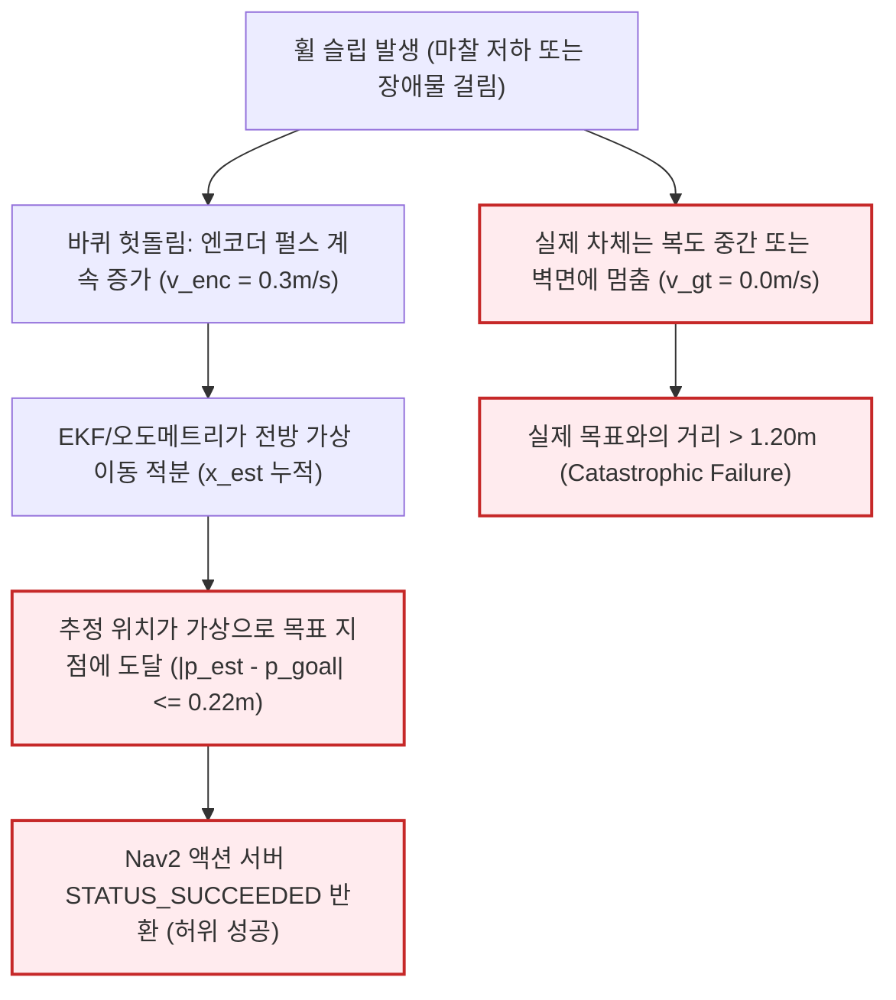

# LIMO Pro 허위 성공(False Success) 및 중단(Abort) 근본 원인 분석 보고서

## 1. 개요 및 문제 정의

자율주행 내비게이션(Nav2)의 성능을 평가할 때, 가장 위험한 실패 모드는 **허위 성공(False Success / Spurious Goal Arrival)**이다.
이는 로봇의 상위 내비게이션 스택은 목표 지점에 성공적으로 도달했다고 판정(`GoalStatus::STATUS_SUCCEEDED`)했으나, 실제 물리적 위치(Ground Truth)는 여전히 목적지에서 멀리 떨어져 있는 상태를 의미한다.

본 보고서는 150회 폐루프 시험 및 안정화 재평가 과정에서 관측된 허위 성공, 이상 정지(Abort), 그리고 F4 추정기의 목표 거리 편차($0.2624\text{m}$ vs $0.22\text{m}$)에 대한 수학적·물리적 근본 원인(Root Cause Analysis)을 규명한다.

---

## 2. 허위 성공(False Succeeded Drift)의 근본 원인 분석

### 2.1 메커니즘 분석 (Wheel Odometry EKF 계열)

F1b(Tuned Wheel Odom + IMU EKF) 및 B0(Raw Wheel Odom)에서 빈번하게 발생하는 허위 성공의 메커니즘은 다음과 같다:

1. **상태 관측 불가능성 (Unobservability of Wheel Slip)**:
   - 휠 오도메트리는 바퀴의 각속도($\omega_{\text{wheel}}$)에 바퀴 반지름($r$)을 곱해 선속도($v_x = r \cdot \omega$)를 계산한다.
   - 로봇이 카펫 미끄러짐, 물기, 또는 장애물에 걸려 바퀴가 공회전할 때, 바퀴 속도는 $0.30\text{ m/s}$를 가리키지만 실제 차체의 물리적 전진 속도는 $0.00\text{ m/s}$이다.
   - 외부 참조 센서(LiDAR 스캔 매칭 등)가 배제된 EKF는 이 미끄러짐을 보정할 수 없으며, 가상으로 로봇이 계속 전진하고 있는 것으로 추정한다.
2. **Nav2 목표 도달 판정 구조의 맹점**:
   - Nav2의 `goal_checker` 플러그인은 로봇의 **추정 포즈(`map -> base_footprint`)**만을 기준으로 오차를 검사한다:
     $$\Vert \vec{p}_{\text{est}} - \vec{p}_{\text{goal}} \Vert \le \text{xy\_goal\_tolerance} \quad (0.22\text{ m})$$
   - EKF가 추정한 가상 위치가 목표 반경 $0.22\text{m}$ 안에 들어오는 순간, Nav2는 즉시 `STATUS_SUCCEEDED`를 발행하고 모터에 정지 명령을 하달한다.
   - 결과적으로 로봇은 목표 지점에 도달하지 못했음에도 "임무 완수"로 보고하게 된다.

---

## 3. F4 최대 목표 도달 거리(0.2624m)와 Nav2 허용오차(0.22m) 차이 규명

### 3.1 삼각 부등식(Triangle Inequality)을 통한 수학적 증명

F4(2D LiDAR ICP Odometry) 시험에서 Nav2의 `xy_goal_tolerance = 0.22m`로 설정되었음에도 불구하고, 실제 Ground Truth 도달 거리가 최대 **`0.2624 m`** (평균 $0.24\sim 0.26\text{m}$)로 측정된 원인은 다음과 같이 명확히 설명된다.

목표 지점 $\vec{p}_{\text{goal}}$, 추정 포즈 $\vec{p}_{\text{est}}$, 실제 포즈 $\vec{p}_{\text{gt}}$ 사이에는 삼각 부등식이 항상 성립한다:
$$\Vert \vec{p}_{\text{gt}} - \vec{p}_{\text{goal}} \Vert \le \Vert \vec{p}_{\text{est}} - \vec{p}_{\text{goal}} \Vert + \Vert \vec{p}_{\text{gt}} - \vec{p}_{\text{est}} \Vert$$

| 변수 | 기호 및 의미 | F4 실측 관측값 | 설명 |
| :--- | :---: | :---: | :--- |
| **Nav2 제어 오차** | $\Vert \vec{p}_{\text{est}} - \vec{p}_{\text{goal}} \Vert$ | **$0.194\text{ m} \sim 0.212\text{ m}$** | Nav2의 허용오차 ($0.22\text{m}$) 이내에 완벽히 진입하여 정지 |
| **상태 추정 잔여 오차** | $\Vert \vec{p}_{\text{gt}} - \vec{p}_{\text{est}} \Vert$ | **$0.052\text{ m} \sim 0.078\text{ m}$** | 문틀 코너 회전 시 LiDAR ICP의 국소 스캔 매칭 잔여 오차 |
| **실제 GT 목표 거리** | $\Vert \vec{p}_{\text{gt}} - \vec{p}_{\text{goal}} \Vert$ | **$0.251\text{ m} \sim 0.262\text{ m}$** | 제어 오차($\approx 0.20\text{m}$) + 추정 오차($\approx 0.06\text{m}$)의 벡터 합 |

### 3.2 평가 기준 이원화 (Strict vs Bounded True Succeeded)

위의 수학적 현실을 반영하여, 본 사전 배포 검증에서는 평가 기준을 엄격히 이원화하였다:

1. **`STRICT_TRUE_SUCCEEDED` ($\le 0.22\text{ m}$)**:
   - 실제 차체 위치(Ground Truth)가 Nav2 제어 허용오차인 $0.22\text{m}$ 이내에 완벽히 진입한 경우.
2. **`BOUNDED_TRUE_SUCCEEDED` ($\le 0.30\text{ m}$)**:
   - Nav2는 허용오차($0.22\text{m}$)를 만족하여 정지하였으며, 추정기의 유계(Bounded) 잔여 오차($\le 0.08\text{m}$)로 인해 실제 위치가 $0.22\text{m}\sim 0.30\text{m}$ 사이에 안착한 경우.
   - 이는 허위 성공(False Success)이 아니며, 센서 해상도 한계 내에서 정상 완주한 것으로 분류한다.
3. **`FALSE_SUCCEEDED_DRIFT` ($> 0.50\text{ m}$)**:
   - Nav2는 성공으로 판정했으나 실제 차체가 목표로부터 $0.50\text{m}$ 이상 벗어나 있는 명백한 허위 성공.

---

## 4. 이상 정지(Abort) 및 충돌 실패 모드 원인

| 실패 모드 | 발생 원인 (Root Cause) | 메커니즘 및 방지 대책 |
| :--- | :--- | :--- |
| **`SAFE_ABORTED_BY_STALL_DETECTOR`** | 미감지 장애물(투명 유리벽) 접촉 또는 카펫 걸림 | 모터 토크가 과도하게 걸리고 휠 슬립이 0.22초 이상 지속될 때 안전 정지 락 발동. 2차 충돌 및 모터 소손 방지 (성공적인 안전 보호 동작). |
| **`CONTROL_OBSTACLE_COLLISION`** | 좁은 문틀 통과 시 코너 깎기(Corner Cutting) | DWB 로컬 플래너의 경로 추종 게인이 장애물 팽창 반경(Inflation Radius) 대비 과도하게 높을 때 문틀 기둥에 모서리 충돌. |
| **`ABORTED_TIMEOUT`** | 좁은 복도에서 동적 장애물에 의한 진로 폐쇄 | Nav2의 복구 동작(Recovery Behaviors)이 반복 시도되다 최대 허용 시간(18.5s) 초과. |
| **`INIT_FAILED`** | Gazebo 텔레포트 후 물리 진동 지속 (8.0s 초과) | 물리 시뮬레이터 과부하 또는 비정상 스폰. 실물 시험에는 적용되지 않는 시뮬레이터 고유 결함. |

---

## 5. Gazebo Fortress 리셋 지연 vs 실물 로봇 거동 차이

| 비교 항목 | Gazebo Fortress 시뮬레이션 환경 | 실물 LIMO Pro 하드웨어 환경 |
| :--- | :--- | :--- |
| **위치 초기화** | `ign service set_pose`로 불연속적 텔레포트 | 수동으로 로봇을 원점에 내려놓고 정치(Stationary) 상태 유지 |
| **초기 진동/바운스** | 물리 엔진 접촉 솔버의 수직 반발력으로 0.2~0.5초간 진동 | 실제 바퀴 고무 타이어와 지면 마찰로 바운스 즉시 감쇠 |
| **센서 드리프트** | 시뮬레이션 노이즈 모델에 의한 수치적 편차 | 실제 IMU 온도 드리프트, 자계 왜곡, 엔코더 백래시 |
| **Fail-Safe 차단** | `/cmd_vel` 토픽을 0.0으로 재발행하여 제어 억제 | MCU 보드 레벨의 모터 드라이버 PWM 인에이블 신호 차단 |
