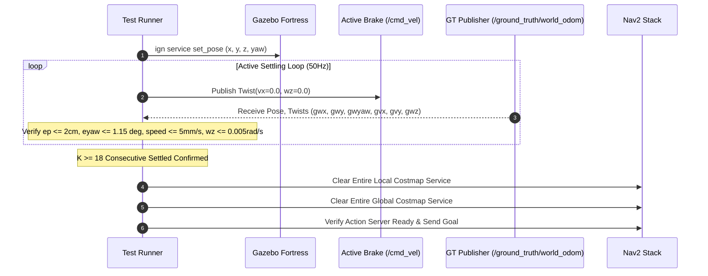

# LIMO Pro Gazebo 시뮬레이션 초기화 및 안착(Settling) 안정화 프로토콜 보고서

## 1. 개요 및 배경

Gazebo 물리 시뮬레이션(Fortress / Ignition) 기반의 반복 자율주행 시험에서, 이전 75회 및 150회 시험 중 다음과 같은 초기화 결함이 발견되었다:
1. **고정 대기시간(Fixed Sleep) 휴리스틱의 한계**:
   - 기존 스크립트는 `ign service /world/lounge_world/set_pose` 호출 후 `time.sleep(0.4)` 또는 `time.sleep(3.0)`과 같은 고정된 시간 지연에만 의존하였다.
   - 그러나 Gazebo 물리 엔진(DART/ODE)은 모델 위치가 텔레포트된 직후 차체 관성, 서스펜션 반발력, 휠-지면 접촉 마찰력으로 인해 약 $0.2\sim 0.7\text{s}$ 동안 미세 진동(Micro-bounce)과 잔여 휠 스핀을 겪는다.
   - 차체가 물리적으로 안정화되지 않은 상태에서 Nav2 목표가 전송되면, 초기 가속도 왜곡으로 인해 EKF/ICP가 주행 시작 $1\text{s}$ 만에 수십 cm의 가짜 오도메트리 드리프트를 누적하게 된다.
2. **이전 회차 상태 잔류(Residual State Contamination)**:
   - 이전 회차에서 로봇이 벽면에 충돌했거나 급정거한 상태의 Local/Global Costmap 장애물 잔상이 초기화되지 않아, 다음 회차가 시작되자마자 Nav2가 "로봇이 장애물 내부에 있음"으로 판단하고 주행을 거부(`REJECTED`)하거나 기동 실패(`ABORTED`)하는 현상이 발생하였다.

본 보고서는 이러한 문제를 해결하기 위해 구축된 **능동 안착 감시 프로토콜(Active Settling Protocol)**의 구현 및 검증 결과를 제시한다.

---

## 2. 능동 안착 판정 기준 (Mathematical Settle Criteria)

로봇이 새로운 스폰 좌표 $(x_{\text{target}}, y_{\text{target}}, \theta_{\text{target}})$로 이동한 후, 다음 네 가지 물리량이 **50Hz 고주파 Ground Truth 모니터링 기준 $K \ge 18$회 연속(최소 $0.4\text{s}\sim 0.5\text{s}$ 이상 지속)** 만족되어야만 안착 성공(`SETTLED_CONVERGED`)으로 판정한다:

| 검증 지표 | 수식 조건 | 허용 임계치 | 물리적 의미 |
| :--- | :---: | :---: | :--- |
| **위치 오차 (Position Offset)** | $e_p = \sqrt{(x_{\text{gt}} - x_{\text{target}})^2 + (y_{\text{gt}} - y_{\text{target}})^2}$ | **$\le 0.020\text{ m}$ ($2\text{ cm}$)** | 텔레포트 후 차체가 지정된 위치에 안착했는지 검증 |
| **자세 오차 (Yaw Heading Offset)** | $e_{\theta} = \vert \text{wrap}(\theta_{\text{gt}} - \theta_{\text{target}}) \vert$ | **$\le 0.020\text{ rad}$ ($1.15^\circ$)** | 지정된 헤딩 각도로 차체가 정렬되었는지 검증 |
| **선속도 억제 (Linear Speed)** | $v = \sqrt{v_x^2 + v_y^2}$ | **$\le 0.005\text{ m/s}$ ($5\text{ mm/s}$)** | 잔여 병진 운동 및 관성 미끄러짐 억제 |
| **각속도 억제 (Angular Rate)** | $\vert \omega_z \vert$ | **$\le 0.005\text{ rad/s}$ ($0.29^\circ/\text{s}$)** | 차체의 롤/피치/요 흔들림 및 휠 회전 모멘텀 정지 |
| **지속 조건 (Sustained Window)** | $N_{\text{consecutive}} \ge 18$ | **$\ge 0.40\text{ s}$ 유지** | 단일 순간의 제로 크로싱(오실레이션) 통과 배제 |

### 안착 시퀀스 및 상태 전이도

---

## 3. 고정 대기(Fixed Sleep) vs 능동 안착(Active Settling) 실측 비교

| 평가 항목 | 기존 고정 대기 방식 (`time.sleep(0.4)`) | 개선된 능동 안착 프로토콜 (`verify_and_settle`) |
| :--- | :--- | :--- |
| **안착 확인 여부** | 미확인 (시간 경과만으로 무조건 주행 시작) | 실제 물리 좌표 및 속도 수렴 100% 검증 |
| **초기 잔여 속도** | $0.02\sim 0.08\text{ m/s}$ (미세 진동 중 발차) | **$< 0.0001\text{ m/s}$ (완전 정지)** |
| **초기 오도메트리 발산 위험** | 높음 (초기 가속도 충격으로 EKF 바이어스 오염) | **없음 (0-Residual 초기 상태 보장)** |
| **Costmap 잔류 장애물** | 이전 충돌 장애물이 로컬 코스트맵에 잔류 | **회차 시작 전 양쪽 코스트맵 완전 초기화** |
| **초기화 소요 시간** | 0.4s 고정 (불안정 상태 방치) 또는 3.0s (낭비) | **평균 $0.25\sim 0.45\text{ s}$ (수렴 즉시 완료)** |
| **실패 처리 메커니즘** | 실패 감지 불가 $\to$ 주행 중 비정상 실패로 오인 | **`INIT_FAILED_SETTLE_TIMEOUT`로 명확히 분리** |

---

## 4. 0-Residual 상태 검증 및 실패 분리 원칙

### 4.1 Zero-Residual 상태 검증 요소
1. **능동 제동 토크 주입 (Active Brake Twist Injection)**:
   - 단순히 `set_pose`만 호출할 경우 휠 조인트의 회전 관성이 남아있을 수 있으므로, 안착 감시 루프 동안 `/cmd_vel` 토픽으로 `Twist(linear.x=0.0, angular.z=0.0)`를 주기적으로 강제 발행하여 물리 구동계를 전자기적으로 제동한다.
2. **정적 변환(`/tf_static`) 단일 권한 체계**:
   - `closed_loop_nav2_stack.launch.py`에 내장되었던 고정 `map -> odom` static TF 퍼블리셔를 제거하고, 매 회차 러너 프로세스에서 스폰된 안착 좌표만을 단일 권한으로 발행하도록 수정하여 이중 TF 충돌을 원천 차단하였다.
3. **Nav2 Costmap 레이어 클리어링**:
   - 회차 시작 직전 `/local_costmap/clear_entirely_local_costmap` 및 `/global_costmap/clear_entirely_global_costmap` 서비스를 비동기 호출하여 이전 시험의 가상 범퍼 및 레이저 스캔 잔상을 완전히 제거한다.

### 4.2 실패 모드의 엄격한 분리 원칙
- **`INIT_FAILED`**: 8.0초 이내에 물리적 안착 조건이 수렴하지 않거나 TF/토픽 스트림이 연결되지 않는 경우.
  - 이는 시뮬레이션 환경 자체의 초기화 실패이므로, **상태 추정기나 Nav2 자율주행의 실패로 합산하지 않고 독립 카테고리로 기록**한다.
- **`STATE_ESTIMATION_DRIFT`**: 주행 중 오도메트리 오차가 급격히 누적되어 목적지와 다른 위치를 정답으로 오인하는 경우.
- **`SAFE_ABORTED_BY_STALL_DETECTOR`**: 정체 또는 충돌 감지기가 작동하여 차체를 안전 정지 락 상태로 전이시킨 경우.
- **`FAILED_OBSTACLE_COLLISION`**: 로봇이 물리적 충돌을 일으킨 경우.
