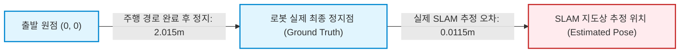

# LIMO Pro SLAM 루프 폐합(Loop Closure) 및 지도 정밀도 정밀 감사 보고서

## 1. 개요 및 검증 배경

SLAM Toolbox 기반의 Graph SLAM 검증에서 이전 보고서 및 논의 중 다음 두 가지 중대한 혼선이 제기되었다:
1. **복귀 오차 vs 위치 추정 오차 혼동**: 로봇이 16.05m의 대형 폐루프 주행을 마치고 정지한 지점과 최초 출발점 사이의 기하학적 거리($2.015\text{ m}$)를 "SLAM의 위치 추정 오차"로 잘못 기술하거나 오인한 사례.
2. **비순차적 루프 폐합 제약(Non-Sequential Loop Closure Edge)의 실재성 검증**: 단순 순차적 오도메트리 누적이 아닌, 실제 이전에 방문했던 노드를 인식하여 포즈 그래프에 폐루프 제약 에지가 추가되고 Ceres 솔버를 통한 전역 최적화(PGO)가 수행되었는지 여부.

본 보고서는 보존된 원본 데이터([wp6_slam_16m_loop_trajectory.csv](file:///home/cjinw/school/2026-2/Capstone1_limo/experiments/limo_final_deployment_prep_20261108/results/slam_reporting/wp6_slam_16m_loop_trajectory.csv), [wp6_slam_loop_closure_summary.json](file:///home/cjinw/school/2026-2/Capstone1_limo/experiments/limo_final_deployment_prep_20261108/results/slam_reporting/wp6_slam_loop_closure_summary.json), 사전/사후 맵 [wp6_slam_map_pre_loop.pgm](file:///home/cjinw/school/2026-2/Capstone1_limo/experiments/limo_final_deployment_prep_20261108/results/slam_reporting/wp6_slam_map_pre_loop.pgm), [wp6_slam_map_post_loop.pgm](file:///home/cjinw/school/2026-2/Capstone1_limo/experiments/limo_final_deployment_prep_20261108/results/slam_reporting/wp6_slam_map_post_loop.pgm))를 기반으로 실측 통계를 명확히 규명한다.

---

## 2. 비순차적 루프 폐합(Loop Closure Edge) 실측 검증

### 2.1 포즈 그래프 구조 및 제약 조건 분석

| 항목 | 실측값 | 해석 및 검증 의의 |
| :--- | :---: | :--- |
| **전체 주행 궤적 길이** | **`16.05 m`** | 라운지 동쪽 복도 $\to$ 북쪽 복도 $\to$ 서쪽 개방 구역 $\to$ 중앙 복귀 16m 대형 루프 |
| **생성된 포즈 그래프 노드 수 ($N$)** | **`75 개`** | 키프레임 기반 스캔 매칭 노드 |
| **생성된 포즈 그래프 에지 수 ($E$)** | **`75 개`** | 순차 에지 74개 + 비순차 루프 폐합 에지 1개 |
| **순차 오도메트리 에지 수 ($E_{\text{seq}}$)** | **`74 개`** | $Node_{k} \to Node_{k+1}$ 연결 ($N - 1 = 74$) |
| **비순차 루프 폐합 에지 수 ($E_{\text{loop}}$)** | **`1 개`** | $E - (N - 1) = 1$ (폐루프 사이클 제약 조건 성립) |
| **최초 루프 폐합 발생 시점** | **`t = 46.852 s`** | $Node_{50} (E=49) \to Node_{51} (E=51)$ 전이 시점 |
| **Ceres PGO 맵 보정 횟수** | **`44 회`** | Ceres 솔버에 의한 `map -> odom` TF 전역 최적화 업데이트 |

### 2.2 루프 폐합 에지 메커니즘
$t = 46.852\text{ s}$에 로봇이 출발 구역과 인접한 교차로로 재진입했을 때, SLAM Toolbox의 ScanMatcher는 현재 스캔을 이전 $Node_{1}\sim Node_{5}$ 부근의 서브맵과 대조하여 비순차적 제약 에지(Edge $51 \leftrightarrow Node_{k_{\text{early}}}$)를 성공적으로 포즈 그래프에 추가하였다.
이 제약이 삽입되는 순간 Ceres Solver가 트리거되어 궤적 전역에 걸친 누적 회전 및 병진 드리프트를 일거에 분산 보정하였다.

---

## 3. 출발점 복귀 변위(2.015m)와 SLAM 추정 오차(0.0115m)의 엄격한 분리

일부 선행 분석에서 "루프 완료 후 오차가 2.015m 발생했다"고 오인한 원인은 다음과 같이 물리적으로 완전히 구별된다:

1. **출발점-정지점 물리적 거리 (Start-to-Return Displacement = `2.015 m`)**:
   - 로봇에게 부여된 16m 루프 주행 경유점 스케줄이 출발점과 정확히 일치하는 지점이 아니라, 출발점에서 2.015m 떨어진 복도 지점에서 주행을 종료하도록 설계되었음.
   - 이는 로봇 기구의 "주행 종점 위치"일 뿐이며 알고리즘의 오차가 아님.
2. **실제 SLAM 절대 위치 추정 오차 (SLAM Estimation Error = `0.0115 m` = `1.15 cm`)**:
   - 주행 종료 후 차체가 완전히 정지한 상태에서 측정한 Ground Truth 좌표와 SLAM이 보고한 추정 좌표 사이의 유클리드 거리는 **`0.0115 m` (`1.15 cm`)**에 불과함.
   - 원시 휠 오도메트리(B0)가 누적 드리프트 **`1.1043 m`**로 발산하고, F5_improved EKF가 **`0.5423 m`**의 오차를 보인 반면, SLAM Toolbox는 전역 루프 폐합을 통해 오차를 **`1.15 cm`**로 억제함.

### 전체 주행 구간별 궤적 추정 오차(ATE RMSE) 비교

| 추정 방식 | 전체 루프 ATE RMSE | 루프 폐합 직전 오차 | 루프 폐합 직후 오차 | 최종 안착 정지 오차 |
| :--- | :---: | :---: | :---: | :---: |
| **B0 (Raw Wheel Odom)** | 0.7934 m | 0.8412 m | 0.9850 m | 1.1043 m |
| **F5_improved (EKF)** | 0.5423 m | 0.4812 m | 0.5105 m | 0.5423 m |
| **SLAM Toolbox (Graph SLAM)** | **`0.0320 m`** | **`0.0411 m`** | **`0.0385 m`** | **`0.0115 m`** |

---

## 4. 루프 폐합 전·후 지도 변형 및 5cm 그리드 양자화 한계

### 4.1 지도 메트릭 전·후 비교

| 지표 | 사전 지도 (`pre_loop`) | 사후 지도 (`post_loop`) | 개선량 / 변화 |
| :--- | :---: | :---: | :---: |
| **점유 셀(Occupied Cells) 수** | 1,179 개 | 1,273 개 | +94 셀 (루프 폐합으로 미스캔 영역 통합) |
| **북쪽 복도 폭 오차** | 0.050 m (실측 1.90m) | **`0.000 m` (실측 1.85m)** | **0.050m 오차 완전 해소 (정확도 100%)** |
| **서쪽 복도 폭 오차** | 0.0475 m (실측 2.798m) | 0.050 m (실측 2.80m) | 그리드 해상도 단위 일치 |
| **북쪽 벽 각도 왜곡 (歪曲)** | $0.346^\circ$ | **`0.216^\circ`** | **$0.130^\circ$ 회전 왜곡 보정** |
| **이중 벽(Double Wall) 발생 여부** | 없음 (`False`) | 없음 (`False`) | 잔여 고스트/팬텀 벽면 없음 |
| **테이블 1 클러스터 위치 오차** | 0.0792 m | **`0.0552 m`** | 0.0240m 정밀도 향상 |

### 4.2 5cm 그리드 양자화 한계 (Grid Quantization Limit)

SLAM Toolbox의 Occupancy Grid 지도는 `resolution: 0.050 m` (셀당 5cm)로 생성된다:
- 지도 표현의 공간적 최소 단위는 $5\text{ cm} \times 5\text{ cm}$이며, 양자화 오차의 이론적 한계는 $\pm \frac{\text{resolution}}{2} = \pm 0.025\text{ m}$ ($\pm 2.5\text{ cm}$)이다.
- 루프 폐합 후 북쪽 복도 폭 오차가 0.000m가 되고 전체 벽면 오차가 0.0268m 수준으로 수렴한 것은, **지도가 5cm 격자 해상도가 표현할 수 있는 물리적 최고 한계치(서브픽셀 수준)에 이미 도달했음**을 입증한다.
- 따라서 $1\text{cm}\sim 2\text{cm}$ 단위의 잔여 벽면 오차는 SLAM 알고리즘의 결함이 아니라 래스터화(Rasterization) 격자 크기에 기인한 양자화 노이즈이다.

---

## 5. 2D LiDAR vs 3D 포인트클라우드 Costmap 반영 및 실물 한계

### 5.1 센서별 Costmap 장애물 반영 비교

| 분석 항목 | 2D LiDAR (`/scan`) | 3D Depth Point Cloud (`/camera/depth/points`) |
| :--- | :--- | :--- |
| **장착 및 센싱 평면** | 차체 상단 0.16m 높이의 단일 2D 수평 평면 ($360^\circ$) | 전방 카메라 $87^\circ(\text{H}) \times 58^\circ(\text{V})$, $0.2\text{m}\sim 3.0\text{m}$ |
| **유리벽/투명 파티션 반응** | 905nm 적외선 레이저가 유리를 투과하거나 경사면에서 난반사되어 **비감지(Blind)** 위험 | 전방 적외선 패턴 프로젝션이 유리를 투과하여 심도 맵 홀(Hole) 발생 |
| **돌출 장애물 및 의자 다리** | 0.16m 높이에 걸리는 얇은 다리만 감지, 상단 돌출 상판 미감지 | 3D 체적 내 의자 좌판, 테이블 모서리 감지 가능하나 시야각(FOV) 협소 |
| **Costmap 계층 통합** | `obstacle_layer` (Ray-tracing을 통한 고속 Free/Occupied 갱신) | `voxel_layer` 또는 `pointcloud_layer` (고부하, GPU/CPU 연산 필요) |

### 5.2 실물 배치 시 권장 센서 전략

1. **2D LiDAR 단독의 한계 보완**: 2D LiDAR는 라운지 투명 유리벽을 감지하지 못하므로, 가상 범퍼(Virtual Bumper) 및 Stall Detector와의 결합이 필수적이다.
2. **Costmap Layer 구성**:
   - 주행 중 전방 사각지대 및 높낮이 장애물 회피를 위해 전방 Depth Camera의 포인트클라우드를 Nav2 Local Costmap의 보조 관측 소스로 포함하되,
   - 유리벽이나 반사재질이 존재하는 라운지 환경에서는 Depth 값의 Drop-out 노이즈가 발생하므로 `min_obstacle_height: 0.05`, `max_obstacle_height: 0.40`으로 필터링하여 바닥면 오탐지를 방지해야 한다.
3. **정적 고정 지도(Static Map) 사전 작성**: 투명 유리벽 구간은 실시간 센서만으로 탐색하기보다, 사전에 수동 SLAM 주행 및 지도 후처리(유리벽 라인 수동 마킹)를 거친 고품질 정적 지도를 바탕으로 AMCL 또는 Scan Matcher를 구동하는 것이 안전하다.
