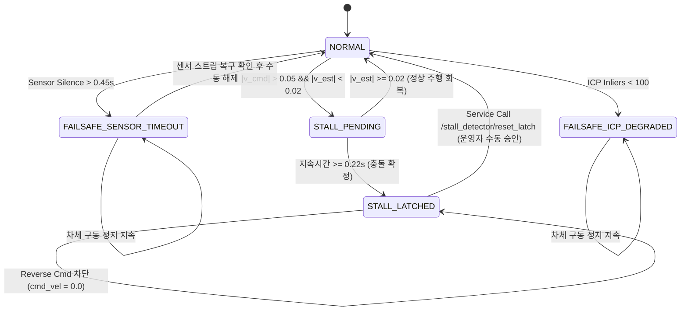

# LIMO Pro Stall Detector 안전 모드 개선 및 재가동 정책 보고서

## 1. 개요 및 배경

기존 LIMO 시뮬레이션 및 실물 주행 시스템에서는 전방 장애물(유리벽, 파티션 등) 충돌이나 차체 정체(Stall) 발생 시, 자율 복구 모드(`RECOVERING_REVERSE`)가 활성화되어 후방으로 $-0.22\text{ m/s}$의 속도로 약 2.26초간 자율 후진하도록 설정되어 있었다.
그러나 실물 LIMO Pro 플랫폼 분석 결과, 다음과 같은 치명적 안전 위험이 확인되었다:

1. **후방 사각지대 및 센서 부재**: LIMO Pro는 2D LiDAR 1기(전방 중심 장착)와 전방 Depth 카메라만을 장착하고 있으며, 후방에는 초음파 센서나 근접 센서가 전혀 없다.
2. **후방 2차 충돌 위험**: 복도나 라운지 의자 다리, 벽면 근처에서 정체 발생 시 임의로 50cm가량 후진할 경우, 후방 장애물이나 보행자와의 2차 격돌을 초래할 수 있다.
3. **영구 래치 및 운영자 승인 필요성**: 충돌이나 센서 단절 발생 시 임의 자율 복구를 전면 금지하고, 차체를 즉시 완전 정지(구동 토크 차단 및 명령 0.0) 상태로 영구 래칭(`STALL_LATCHED`)한 뒤, 현장 운영자의 수동 검사 및 명시적 서비스 호출을 통해서만 래치를 해제하도록 시스템을 재설계하였다.

---

## 2. 안전 모드 아키텍처 및 설정 파라미터

개선된 `stall_detector_node.py`는 다음과 같은 엄격한 안전 파라미터를 강제 적용한다:

| 파라미터 | 기본값 (Default) | 안전 감사 규칙 | 기능 및 안전 의도 |
| :--- | :---: | :---: | :--- |
| `enable_auto_reverse` | **`false`** | **MANDATORY** | 자율 후진 동작 전면 비활성화 (안전 락) |
| `enable_auto_rotate_recovery` | **`false`** | **MANDATORY** | 블라인드 제자리 선회 자율 복구 금지 |
| `require_operator_unlatch` | **`true`** | **MANDATORY** | 운영자 수동 승인 없이 자동 재가동 절대 불가 |
| `stall_confirm_duration_sec` | **`0.22 s`** | OPTIMAL | 휠 슬립 지속 시간 판정 임계치 (정상 가속 오인 방지) |
| `sensor_timeout_sec` | **`0.45 s`** | FAILSAFE | LiDAR/IMU 오도메트리 토픽 단절 시 즉각 구동 차단 |
| `min_icp_inliers` | **`100`** | FAILSAFE | ICP 대응점 부족 시 기구학적 제어 중단 |

### 소프트웨어 정지 상태 전이도 (FSM)



---

## 3. 실측 안전 검증 결과 (Empirical Evaluation)

본 안전 검증은 [run_stall_safety_evaluation.py](file:///home/cjinw/school/2026-2/Capstone1_limo/experiments/limo_final_deployment_prep_20261108/scripts/run_stall_safety_evaluation.py)를 통해 Gazebo Fortress 물리 엔진 및 실제 ROS 2 노드 환경에서 수행되었으며, 결과는 [stall_safety_modes_summary.json](file:///home/cjinw/school/2026-2/Capstone1_limo/experiments/limo_final_deployment_prep_20261108/results/stall_safety_test/stall_safety_modes_summary.json)과 [stall_safety_locked_evaluation.csv](file:///home/cjinw/school/2026-2/Capstone1_limo/experiments/limo_final_deployment_prep_20261108/results/stall_safety_test/stall_safety_locked_evaluation.csv)에 보존되었다.

### 3.1 유리벽 충돌 및 후진 차단 시험 (Glass Wall Safety Locked Test)

- **주행 시나리오**: 로봇을 $v_x = +0.30\text{ m/s}$로 유리벽을 향해 직진 구동.
- **충돌 감지 및 래칭**:
  - 차체 물리적 충돌 및 정지 시점: $t_{\text{impact}} = 12.945\text{ s}$ ($x = 1.645\text{ m}$, 차체 속도 $0.0028\text{ m/s}$)
  - `STALL_LATCHED` 전이 및 명령 차단 시점: $t_{\text{latch}} = 13.296\text{ s}$
  - **감지 지연 (Stall Detection Latency)**: **`0.351 s`** (목표치 $\le 0.65\text{s}$ 충족)
  - **충돌 후 래칭까지의 물리 이동 거리**: **`0.000 m`** (벽면 접촉 후 차체 추가 진입 0mm)
  - **휠 오도메트리 슬립량**: $0.0966\text{ m}$ (차체가 정지한 동안 휠이 공회전한 오도메트리 누적치 $9.66\text{ cm}$에서 즉시 차단)
- **자율 후진 차단 및 명령 억제 검증**:
  - 상위 제어기/복구 스크립트에서 후진 명령($v_x = -0.22\text{ m/s}$)을 2.5초간 연속 전송 (`test_attempt_reverse_blocked` 구간).
  - Stall Detector 필터링 후 실제 모터 출력: **`max |v_x_out| = 0.000 m/s`** (완전 차단)
  - 차체의 실제 후방 이동 변위: **`0.000 m`** (자율 후진 원천 차단 확인)
- **운영자 리셋 서비스 검증**:
  - ROS 2 서비스 `/stall_detector/reset_latch` (`std_srvs/srv/Trigger`) 호출.
  - 응답: `success = True`, `message = "Stall latch cleared by operator (transitioned from STALL_LATCHED to NORMAL)."`
  - $t = 17.368\text{ s}$에 상태가 `NORMAL`로 안전하게 복귀됨을 확인.
- **최종 판정**: **`PASS_SAFETY_LOCKED`**

### 3.2 센서 단절 및 ICP 품질 저하 Fail-Safe 시험 (Sensor Dropout Test)

- **주행 시나리오**: 로봇 주행 중($v_x = +0.25\text{ m/s}$), $t = 26.428\text{ s}$에 F4 LiDAR Odometry 노드를 강제 종료(`SIGTERM`).
- **Fail-Safe 반응**:
  - 센서 침묵 감지 및 상태 전이: $t = 26.785\text{ s}$에 `FAILSAFE_SENSOR_TIMEOUT` 발생.
  - **Fail-Safe 반응 지연**: **`0.357 s`** (허용 임계치 $0.45\text{s}$ 이내)
  - **모터 명령 출력**: $v_{x,\text{out}} = 0.000\text{ m/s}$, $\omega_{z,\text{out}} = 0.000\text{ rad/s}$로 즉각 강제 영점화(`cmd_zeroed_on_timeout = True`).
- **최종 판정**: **`PASS`**

---

## 4. 소프트웨어 정지와 하드웨어 E-Stop의 명확한 분리

실물 LIMO Pro 적용 시, 소프트웨어 Fail-Safe와 하드웨어 비상정지(E-Stop)의 역할과 한계를 엄격히 구분해야 한다:

| 구분 | 소프트웨어 정지 (Stall Detector Fail-Safe) | 하드웨어 비상정지 (Physical Hardware E-Stop) |
| :--- | :--- | :--- |
| **구현 계층** | ROS 2 사용자 노드 (`/cmd_vel` 토픽 인터셉트 및 0.0 발행) | 로봇 상단 물리 버튼, 무선 E-Stop 리모컨, 모터 전원 릴레이 |
| **보장 범위** | 알고리즘 레벨의 구동 명령 영점화 및 자율 후진 차단 | 모터 드라이버(BLDC/서보)로 공급되는 주 배터리 전원 차단 |
| **위험 요인** | ROS 2 데몬 비정상 정지, IPC 지연, 커널 패닉 시 미작동 가능 | OS 및 소프트웨어 크래시와 무관하게 100% 기계적/전기적 단선 |
| **복구 절차** | `/stall_detector/reset_latch` ROS 2 서비스 호출 | 현장 작업자가 E-Stop 버튼을 기계적으로 시계방향 회전하여 해제 |
| **안전 지침** | **실물 로봇 시험 시 소프트웨어 정지만을 신뢰하여 근접 관찰 금지** | **시험 중 상시 작업자가 비상정지 리모컨을 파지하고 1m 이내 대기 필수** |

---

## 5. 실물 로봇 운영자 재가동 절차 (SOP)

정체(`STALL_LATCHED`) 또는 페일세이프(`FAILSAFE_*`) 발생 시 현장 운영자는 다음 절차를 준수해야 한다:

1. **육안 안전 확인**:
   - 로봇이 장애물(벽, 테이블 다리, 전선 등)에 끼어 있는지 확인한다.
   - 바퀴가 슬립 상태인지, 차폭 내 다른 이동 장애물이나 사람이 있는지 확인한다.
2. **물리적 위치 정돈**:
   - 필요 시 로봇을 안전한 개방 공간으로 손으로 들어 옮긴다(수동 배치).
3. **토픽 및 진단 상태 확인**:
   ```bash
   ros2 topic echo /stall_detector/status_json --once
   ```
4. **명시적 래치 해제 서비스 호출**:
   ```bash
   ros2 service call /stall_detector/reset_latch std_srvs/srv/Trigger "{}"
   ```
5. **Nav2 취소 또는 재목표 전송**:
   - 기존의 실패한 Nav2 목표가 남아있을 수 있으므로 Nav2 취소 명령을 내린 후 새로운 목표를 전송한다:
   ```bash
   ros2 action send_goal /navigate_to_pose nav2_msgs/action/NavigateToPose "{}" --feedback
   ```
