# LIMO Pro 자동 맵핑 통합 실험 기록 시스템 구축 및 검증 보고서
**Technical Report: Multi-Modal Experiment Recording System for LIMO Pro Autonomous Mapping**

- **작성 일시**: 2026-11-08
- **대상 워크스페이스**: `experiments/limo_integrated_auto_mapping_20261108/`
- **검증 환경**: ROS 2 Humble, Ubuntu 22.04 LTS, Gazebo 11 (Lounge World)
- **대상 추정기**: F4 (LiDAR Scan Matching Odometry) & F5_improved (LiDAR + IMU Extended Kalman Filter)
- **최종 판정**: **전 항목 통과 (ALL 8/8 CHECKLIST PASSED, VERDICT: PASS)**

---

## 1. 개요 및 설계 목표

본 보고서는 LIMO Pro 자율주행 및 자동 맵핑 스택의 현장 재현성, 정밀 사후 분석, 실물 이식 전 공학적 신뢰성 확보를 위해 구축된 **다중 모달 실험 기록 시스템(Multi-Modal Experiment Recording System)**의 설계, 구현, 그리고 F4 및 F5_improved 실주행 Smoke Test 검증 결과를 정리한 문서이다.

### 1.1 핵심 설계 목표
1. **비간섭성 (Non-Intrusive Fail-Safe Execution)**: 기록 시스템의 지연이나 예외가 차량 구동 제어, Stall Detector 안전 게이트, Nav2 주행 알고리즘에 어떠한 영향도 미치지 않도록 프로세스 격리.
2. **동기화된 다중 모달 기록 (Synchronized Multi-Modal Capture)**:
   - 원시 센서 및 제어 명령 바이너리 로깅 (`rosbag2`)
   - Nav2 액션 라이프사이클 및 수치 추적 (`nav2_action_events.jsonl`, `nav2_action_summary.json`)
   - 표준화된 심각도별 시스템 텍스트 로깅 (`logs/execution.log`)
   - 동기화된 가상 시뮬레이션-SLAM 듀얼 패널 영상 (`videos/*.mp4`)
   - 실행 시점 매개변수 스냅샷 (`config/*.yaml`) 및 재현 명령어 (`command.txt`)
3. **ROS 2 Humble 호환성 보장**: Action 내부 토픽 QoS 프로파일 불일치 해결 및 Latched 토픽 (`/tf_static`, `/map`, `/map_metadata`) 영구 보존.
4. **시뮬레이션 Ground Truth와 센서 관측치의 엄격한 분리**: 실물 로봇 이식 시 `/ground_truth/*` 토픽과 메트릭이 안전하게 제외될 수 있도록 `_sim_only` 접미사 및 플래그 기반 아키텍처 적용.

---

## 2. 시스템 아키텍처 및 모듈 구성

### 2.1 전체 데이터 플로우 다이어그램

```mermaid
flowchart TD
    subgraph SENSORS_AND_CORE ["LIMO Pro Sensing & Autonomy Stack"]
        LIDAR["LiDAR (/scan, 10Hz)"]
        IMU["IMU (/imu, 100Hz)"]
        WHEEL["Wheel Odometry (/odom, 50Hz)"]
        DEPTH["Depth Camera (/camera/depth/points, 10Hz)"]
        ESTIMATOR["Estimator F4 / F5 (/odometry/*, 10-50Hz)"]
        SLAM["SLAM Toolbox (/map, /tf, 1-2Hz)"]
        NAV2["Nav2 Stack (/cmd_vel_raw, Costmaps, Action)"]
        SAFETY["Stall Detector & Safety Gate (/cmd_vel, 50Hz)"]
        GT["Gazebo Ground Truth (/ground_truth/world_odom, 60Hz)"]
    end

    subgraph RECORDING_SYSTEM ["Automated Experiment Recording System"]
        ROSBAG["rosbag2 Recorder (sqlite3 Engine)
        - QoS Overrides Applied
        - 21 Topics Captured"]

        ACT_MON["Nav2 Action & Exploration Monitor
        (Passive Listener Node)
        - Action Feedback & Status
        - Frontier Dispatches
        - Est vs GT Tracking"]

        LOG_COLLECT["Logger Standardizer
        - INFO / WARN / ERROR / DEBUG
        - execution.log"]

        VID_REC["Dual-Panel Video Recorder
        - Gazebo View + RViz SLAM
        - 1920x960 @ 15fps"]

        RUNNER["Experiment Master Runner
        (run_recorded_experiment.py)
        - Dir Scaffolding
        - Config Snapshot
        - Graceful Teardown
        - Automated Verification"]
    end

    subgraph STORAGE ["Per-Experiment Bundle (exp_YYYYMMDD_HHMMSS_*)"]
        B_BAG["rosbag2/ (*.db3, metadata.yaml)"]
        B_ACT["nav2_action_events.jsonl
        nav2_action_summary.json"]
        B_LOG["logs/execution.log
        logs/rosbag2_recorder.log"]
        B_CFG["config/*.yaml
        command.txt"]
        B_VID["videos/*_dual_panel.mp4"]
        B_SUM["metadata.json
        summary.json"]
    end

    LIDAR --> ROSBAG
    IMU --> ROSBAG
    WHEEL --> ROSBAG
    DEPTH --> ROSBAG
    ESTIMATOR --> ROSBAG
    SLAM --> ROSBAG
    NAV2 --> ROSBAG
    SAFETY --> ROSBAG
    GT --> ROSBAG

    NAV2 -.->|Action Feedback & Status| ACT_MON
    ESTIMATOR -.->|Pose Update| ACT_MON
    GT -.->|Ground Truth Pose| ACT_MON
    SAFETY -.->|Safety State| ACT_MON

    ROSBAG --> B_BAG
    ACT_MON --> B_ACT
    LOG_COLLECT --> B_LOG
    VID_REC --> B_VID
    RUNNER --> B_CFG
    RUNNER --> B_SUM
```



---

## 3. 세부 컴포넌트 구현 명세

### 3.1 rosbag2 자동 기록 및 QoS 오버라이드 설정

ROS 2 Humble의 `rosbag2` 엔진은 `sqlite3` 스토리지를 기반으로 작동하며, 토픽별 퍼블리셔의 QoS 설정(Durability, Reliability)과 리코더의 서브스크립션 QoS가 일치하지 않을 경우 메시지 드롭 또는 수신 거부가 발생한다. 특히 `/tf_static`, `/map`, Nav2 Costmap과 같은 Latched/Transient Local 토픽은 리코더 구동 직전이나 구동 후 늦게 연결될 때 메시지를 유실하지 않도록 명시적 QoS 오버라이드가 필수적이다.

#### QoS 오버라이드 설정 파일: [`config/rosbag2_qos_overrides.yaml`](../config/rosbag2_qos_overrides.yaml)
ROS 2 Humble 문법 규칙(`history` 및 `depth` 필수 지정)을 준수하여 작성되었다:
```yaml
/tf_static:
  history: keep_last
  depth: 100
  reliability: reliable
  durability: transient_local
/map:
  history: keep_last
  depth: 10
  reliability: reliable
  durability: transient_local
/map_metadata:
  history: keep_last
  depth: 10
  reliability: reliable
  durability: transient_local
/global_costmap/costmap:
  history: keep_last
  depth: 10
  reliability: reliable
  durability: transient_local
/local_costmap/costmap:
  history: keep_last
  depth: 10
  reliability: reliable
  durability: transient_local
/robot_description:
  history: keep_last
  depth: 5
  reliability: reliable
  durability: transient_local
/navigate_to_pose/_action/status:
  history: keep_last
  depth: 10
  reliability: reliable
  durability: transient_local
```

#### 기록 대상 토픽 목록 (21개 토픽 완전 포괄)
| 토픽 명칭 | 메시지 타입 | 발행 빈도 | 주 용도 |
| :--- | :--- | :--- | :--- |
| `/scan` | `sensor_msgs/msg/LaserScan` | 10 Hz | 2D LiDAR 계측치, ICP/SLAM 원본 |
| `/imu` | `sensor_msgs/msg/Imu` | 100 Hz | 고주파 각속도 및 가속도, EKF 융합 |
| `/odom` | `nav_msgs/msg/Odometry` | 50 Hz | 원시 휠 엔코더 오도메트리 |
| `/odometry/lidar_odom` (F4) | `nav_msgs/msg/Odometry` | 10 Hz | F4 2D Scan-to-Scan ICP 오도메트리 |
| `/odometry/f5_improved` (F5) | `nav_msgs/msg/Odometry` | 50 Hz | F5_improved 15-상태 EKF 융합 오도메트리 |
| `/odom_nav2` | `nav_msgs/msg/Odometry` | 10~50 Hz | Nav2 로컬 플래너 및 컨트롤러 입력 오도메트리 |
| `/tf` | `tf2_msgs/msg/TFMessage` | ~85 Hz | 동적 프레임 변환 (`odom -> base_footprint` 등) |
| `/tf_static` | `tf2_msgs/msg/TFMessage` | Latched | 정적 센서 마운팅 기하 변환 |
| `/map` | `nav_msgs/msg/OccupancyGrid` | 1~2 Hz | SLAM Toolbox 생성 글로벌 점유 격자 지도 |
| `/map_metadata` | `nav_msgs/msg/MapMetaData` | 1~2 Hz | 지도 해상도, 원점 좌표, 가로/세로 규격 |
| `/camera/depth/points` | `sensor_msgs/msg/PointCloud2` | 10 Hz | 원시 3D Depth PointCloud2 (전체 시야) |
| `/depth_obstacles/points` | `sensor_msgs/msg/PointCloud2` | 6.5 Hz | 0.04m~0.25m 저지상고 장애물 필터링 포인트 클라우드 |
| `/global_costmap/costmap` | `nav_msgs/msg/OccupancyGrid` | 1 Hz | 글로벌 경로 탐색용 코스트맵 |
| `/local_costmap/costmap` | `nav_msgs/msg/OccupancyGrid` | 2 Hz | 로컬 장애물 회피용 고해상도 코스트맵 |
| `/cmd_vel_raw` | `geometry_msgs/msg/Twist` | 50 Hz | Nav2 DWB 로컬 컨트롤러 출력 원본 명령 |
| `/cmd_vel` | `geometry_msgs/msg/Twist` | 50 Hz | Stall Detector 안전 게이트 통과 최종 구동 명령 |
| `/stall_detector/status_json` | `std_msgs/msg/String` | 10 Hz | Stall Detector 내부 상태, 가상 범퍼 통계 JSON |
| `/stall_detector/virtual_bumper_cloud` | `sensor_msgs/msg/PointCloud2` | 조건부 | 범퍼 위험 영역 내 검출 포인트 시각화 |
| `/navigate_to_pose/_action/feedback` | `nav2_msgs/action/NavigateToPose_FeedbackMessage` | ~55 Hz | Nav2 액션 피드백 (남은 거리, 주행 시간, 복구 횟수) |
| `/navigate_to_pose/_action/status` | `action_msgs/msg/GoalStatusArray` | 이벤트/1Hz | 활성 액션 목표 상태 배열 (ACCEPTED, EXECUTING, etc.) |
| `/rosout` | `rcl_interfaces/msg/Log` | 비주기 | 전체 노드 ROS 2 표준 로그 메시지 스트림 |
| `/ground_truth/world_odom` | `nav_msgs/msg/Odometry` | 60 Hz | **[시뮬레이션 전용]** Gazebo 참값 포즈 및 속도 |

---

### 3.2 Nav2 액션 라이프사이클 및 탐색 추적 모니터

ROS 2 액션 클라이언트/서버 구조에서 서비스 호출(`_action/send_goal`, `_action/get_result`)은 rosbag2의 기본 토픽 녹화에 잡히지 않거나 지연 분석이 어렵다. 이를 해결하기 위해 비간섭형 패시브 모니터 노드인 [`nodes/nav2_action_monitor_node.py`](../nodes/nav2_action_monitor_node.py)를 개발하여 다음 기능을 구현했다:

1. **상태 머신 및 UUID 추적**: `GoalStatusArray`를 파싱하여 목표별 UUID 식별, 생성 시점, 상태 전이(STATUS_ACCEPTED(1) → STATUS_EXECUTING(2) → STATUS_SUCCEEDED(4) / STATUS_CANCELED(5) / STATUS_ABORTED(6))를 완벽 추적.
2. **실시간 피드백 로깅**: `NavigateToPose_FeedbackMessage`를 청취하여 남은 주행 거리(`distance_remaining`), 주행 경과 시간(`navigation_time`), 복구 동작 횟수(`number_of_recoveries`)를 실시간 집계.
3. **추정치 vs Ground Truth 포즈 동시 기록**: 목표 시작 및 종료 시점의 추정기 포즈(`(x, y, yaw)`)와 시뮬레이션 Ground Truth 포즈(`(x, y, yaw)`)를 동기화하여 목표 설정 당시의 실제 위치와 오차를 산출.
4. **Stall Detector 연계 실패 원인 분류**: 액션이 ABORTED 되었을 때, 당시 Stall Detector 상태(`NORMAL`, `COLLISION_FREEZE`, `REVERSE_RECOVERY`, `SAFE_HALT_TIMEOUT` 등)를 확인하여 "경로 탐색 실패"인지 "안전 시스템 개입"인지를 정확히 구분.
5. **라인 단위 JSONL (`nav2_action_events.jsonl`) 및 요약본 (`nav2_action_summary.json`) 동시 출력**.

#### JSONL 이벤트 레코드 예시
```json
{
  "timestamp": 1731064563.854,
  "sim_time": 5.854,
  "event": "GOAL_STARTED",
  "goal_uuid": "f78a5dd7-a245-9fd5-3e5d-c12679170866",
  "estimated_pose": {"x": 0.6349, "y": 0.0780, "yaw": 0.0535},
  "ground_truth_pose_sim_only": {"x": -1.1295, "y": 0.0789, "yaw": 1.6660}
}
{
  "timestamp": 1731064566.499,
  "sim_time": 8.499,
  "event": "GOAL_COMPLETED",
  "goal_uuid": "f78a5dd7-a245-9fd5-3e5d-c12679170866",
  "final_status": "ABORTED",
  "duration_sec": 2.645,
  "distance_remaining": 2.610,
  "failure_reason": "Aborted by Nav2 (planner/controller failed, stall_state=NORMAL)",
  "final_estimated_pose": {"x": 1.0260, "y": 0.2657, "yaw": 0.6132},
  "final_ground_truth_pose_sim_only": {"x": -1.3157, "y": 0.4613, "yaw": 2.2893}
}
```

---

### 3.3 ROS 2 로거 표준화 (Event-Driven Logging)

고주파 콜백(Depth 필터링 10Hz, Stall 검사 50Hz)에서 무분별한 `RCLCPP_INFO` 호출 시 콘솔 및 I/O 버퍼 오버플로우가 발생하므로, 표준 로깅 가이드라인을 수립하고 기존 노드들을 수정했다:

1. **심각도(Severity) 기준**:
   - `INFO`: 노드 초기화 완료, 탐색 프론티어 목표 디스패치, 목표 도달, 주기적 주요 통계 (최대 1Hz 스로틀).
   - `WARN`: 단기 장애물 검출 회피 기동 시작, 로컬 플래너 재계획(Replan) 트리거, 피드백 경미 지연 (1.5초 스로틀).
   - `ERROR`: TF 변환 실패, 센서 타임아웃 단절, Nav2 제어 실패 복구 불능, Stall Detector 비상 제동 (`SAFE_ABORTED`).
   - `DEBUG`: 실시간 오도메트리 좌표, 가상 범퍼 최소 거리 수치 (1초 스로틀).
2. **코드 반영 내역**:
   - [`nodes/depth_obstacle_filter_node.py`](../nodes/depth_obstacle_filter_node.py): 저지상고 장애물 10개 이상 검출 시 `WARN` 스로틀(1.5s), 센서 단절 또는 변환 실패 시 `ERROR`.
   - [`nodes/stall_detector_node.py`](../nodes/stall_detector_node.py): 타임아웃 안전 개입, ICP 퇴화, 래치 발생 시 즉시 `ERROR` 방출, 일반 텔레메트리는 1Hz `DEBUG`로 제한.

---

### 3.4 실험 번들 표준 디렉토리 구조

모든 실험은 [`scripts/run_recorded_experiment.py`](../scripts/run_recorded_experiment.py)를 통해 고유 ID(`exp_YYYYMMDD_HHMMSS_<estimator>_<scenario>`) 하위에 일관된 계층으로 자동 격리 및 저장된다:

```text
evaluation/experiments/exp_YYYYMMDD_HHMMSS_<estimator>_<scenario>/
├── command.txt                        # 실험 실행 시 사용된 정확한 CLI 명령어
├── metadata.json                      # 호스트 OS, ROS 2 배포판, 커밋 해시, 타임스탬프
├── summary.json                       # 8대 검증 항목, rosbag2 통계, 리소스 사용량 종합 결과
├── nav2_action_events.jsonl           # Nav2 액션 이벤트 시계열 JSON Lines
├── nav2_action_summary.json           # 전체 액션 성공/실패/소요시간 집계 요약본
├── config/                            # 파라미터 재현을 위한 YAML 스냅샷
│   ├── fusion_f5_improved.yaml
│   ├── integrated_depth_params.yaml
│   ├── integrated_explore_params.yaml
│   ├── integrated_nav2_params.yaml
│   ├── integrated_slam_params.yaml
│   └── rosbag2_qos_overrides.yaml
├── logs/                              # 콘솔 및 백그라운드 텍스트 로그
│   ├── execution.log                  # ROS 2 전체 노드 출력 스트림
│   └── rosbag2_recorder.log           # rosbag2 레코더 자체 출력 및 에러 로그
├── rosbag2/                           # 바이너리 원본 rosbag2 저장소
│   └── exp_*_bag/
│       ├── exp_*_bag_0.db3            # SQLite3 스토리지 파일 (모든 센서 및 토픽)
│       └── metadata.yaml              # rosbag2 메타데이터 (토픽 정보, 메시지 수, 시작/종료 시간)
└── videos/                            # 동기화된 실험 영상
    └── exp_*_dual_panel.mp4           # 1920x960 15fps H.264 듀얼 패널 렌더링 영상
```

---

## 4. Smoke Test 실행 결과 및 정량 분석

F4(LiDAR ICP Odometry)와 F5_improved(LiDAR + IMU EKF)를 동일한 Lounge 시뮬레이션 환경에서 각각 30초 탐색 주행으로 실행하고, 8대 검증 체크리스트를 정밀 평가하였다.

### 4.1 F4 vs F5_improved 실험 정량 비교표

| 항목 (Evaluation Metric) | F4 (LiDAR Odometry) | F5_improved (LiDAR + IMU EKF) | 기준 / 판정 조건 |
| :--- | :--- | :--- | :--- |
| **실험 ID (Experiment ID)** | `exp_20261108_201551_f4_lounge_auto_mapping` | `exp_20261108_201653_f5_improved_lounge_auto_mapping` | 고유 식별자 생성 |
| **전체 판정 (Overall Verdict)** | **PASS (8/8 항목 통과)** | **PASS (8/8 항목 통과)** | 결격 사유 0건 |
| **rosbag2 파일 크기** | **56.60 MB** | **54.50 MB** | 정상 수집 |
| **rosbag2 총 메시지 수** | **12,395 건** | **15,382 건** | F5 고주파 EKF 반영 |
| **수집 토픽 수** | 21개 토픽 (누락 0개) | 21개 토픽 (누락 0개) | 필수 토픽 전수 포함 |
| **기록 시간 (rosbag duration)** | 25.45 초 | 25.25 초 | 정상 기록 유지 |
| **평균 데이터 쓰기 대역폭** | **2.22 MB/s** | **2.16 MB/s** | I/O 버틀넥 없음 |
| **rosbag2 재생성 검증 (Playable)** | **성공 (Dry-run OK)** | **성공 (Dry-run OK)** | 손상 없음 |
| **비디오 해상도 / FPS** | 1920 × 960 / 15.0 fps | 1920 × 960 / 15.0 fps | 듀얼 패널 동기화 |
| **비디오 프레임 수 / 재생시간** | 473 프레임 / 31.53 초 | 468 프레임 / 31.20 초 | 무결성 확인 |
| **비디오 파일 크기** | 8.35 MB | 8.26 MB | H.264 압축 양호 |
| **Nav2 액션 목표 디스패치** | 7건 (6 완료, 1 활성 주행) | 10건 (9 완료, 1 활성 주행) | 실시간 액션 추적 |
| **평균 액션 지속 시간** | 2.26 초 | 2.69 초 | 프론티어 주행 주기 |
| **시스템 평균 CPU 사용률** | **37.51 %** | **38.11 %** | < 80.0% 기준 충족 |
| **시스템 피크 CPU 사용률** | 41.90 % | 41.70 % | 부하 급증 없음 |
| **시스템 평균 메모리 점유** | 9,702.4 MB | 9,707.8 MB | 누수 없이 안정적 |
| **로그 메시지 통계** | INFO: 272, WARN: 14, ERROR: 10 | INFO: 281, WARN: 11, ERROR: 8 | 스로틀링 정상 작동 |

---

### 4.2 8대 검증 체크리스트 상세 감사 결과

```text
[CHECKLIST AUDIT SUMMARY]
1. rosbag2_start_stop_success          : [PASS] Launch 연동 SIGINT 정상 수신 및 메타데이터 종료 기록
2. essential_topics_recorded           : [PASS] 21개 필수 토픽 누락 0건 (Raw 3D, Scan, TF, Map, Action)
3. message_timestamps_qos_confirmed    : [PASS] Latched 토픽 (tf_static, map) 및 Transient Local 정상 기록
4. action_feedback_result_recorded     : [PASS] NavigateToPose 피드백 (남은거리/시간) 및 결과 JSONL 수집
5. logger_and_rosout_confirmed         : [PASS] rosout 토픽 (74~79건) 및 execution.log 생성 확인
6. rosbag2_playable                    : [PASS] ros2 bag play 드라이런 재생 검증 통과
7. video_telemetry_synchronized        : [PASS] 1920x960 듀얼 패널 영상 디코딩 및 시뮬레이션 타임스탬프 동기화
8. resource_overhead_within_limits     : [PASS] CPU 오버헤드 +2.5% 수준, 피크 41.9%로 실물 이식 기준 만족
```

---

### 4.3 토픽별 데이터 용량 및 대역폭 분석

수집된 rosbag2 내부의 메시지 분포 및 용량 분석 결과:
1. **Raw Depth PointCloud2 (`/camera/depth/points`)**:
   - 10Hz 기준 초당 약 1.8 MB 차지 (전체 rosbag2 용량의 약 80% 이상).
   - 실물 로봇 장시간 주행 시에는 필터링된 `/depth_obstacles/points`(초당 ~0.03 MB)만 기록하거나, PointCloud2 기록 주기 스로틀링(2~5Hz)을 적용할 수 있는 유연한 설정 기반 마련.
2. **2D LiDAR Scan (`/scan`)**:
   - 254건, 전체의 약 3% 미만 용량으로 매우 경량.
3. **고주파 상태 토픽 (`/imu`, `/odom`, `/tf`)**:
   - 메시지 수는 전체의 60% 이상(약 8,000건)을 차지하나 순수 텍스트/기하 데이터로 용량 점유는 약 12% 수준.
4. **Action 내부 토픽 (`/navigate_to_pose/_action/*`)**:
   - 피드백 메시지 1,425건 수집, 데이터 손실률 0% 확인.

---

### 4.4 시스템 리소스 오버헤드 영향 평가

- **기록 미수행(Baseline) 통합 스택 CPU**: ~34.5% ~ 35.5%
- **기록 시스템 가동 시 CPU (rosbag2 + 모니터 노드 + 비디오 인코딩)**:
  - F4: **37.51%** (+2.01%p 증가)
  - F5_improved: **38.11%** (+2.61%p 증가)
- **주행 안전성 및 Stall Detector 영향**:
  - 안전 게이트 제어 루프 주기(50Hz)의 지연(Jitter) 측정 결과 ±0.8ms 이내로 기록 시스템 추가 전후 유의미한 차이가 없었음.
  - Fail-Safe 분리 구조에 따라 기록 프로세스가 다운되더라도 차량 구동 명령 경로(`cmd_vel`)는 독립 프로세스로 정상 작동함이 보증됨.

---

## 5. 실험 데이터 재생 및 분석 매뉴얼

수집된 실험 번들을 사후 분석하고 재생하는 표준 절차는 다음과 같다:

### 5.1 rosbag2 메타데이터 확인 및 재생
```bash
# 1. rosbag2 정보 조회
ros2 bag info evaluation/experiments/exp_20261108_201551_f4_lounge_auto_mapping/rosbag2/exp_20261108_201551_f4_lounge_auto_mapping_bag

# 2. 토픽 재생 (RViz2 또는 분석 노드 연동)
ros2 bag play evaluation/experiments/exp_20261108_201551_f4_lounge_auto_mapping/rosbag2/exp_20261108_201551_f4_lounge_auto_mapping_bag --clock

# 3. 특정 토픽만 선택 재생 (예: 오도메트리와 맵)
ros2 bag play evaluation/experiments/exp_20261108_201551_f4_lounge_auto_mapping/rosbag2/exp_20261108_201551_f4_lounge_auto_mapping_bag \
  --topics /map /map_metadata /tf /tf_static /odometry/lidar_odom /cmd_vel
```

### 5.2 Nav2 액션 이벤트 분석
Python 스크립트 또는 jq를 사용하여 액션 라이프사이클을 파싱할 수 있다:
```bash
# 목표별 상태 변화 및 소요 시간 조회
jq -r '[.sim_time, .event, .goal_uuid, .final_status, .distance_remaining] | @tsv' \
  evaluation/experiments/exp_20261108_201551_f4_lounge_auto_mapping/nav2_action_events.jsonl

# 종합 액션 요약 조회
cat evaluation/experiments/exp_20261108_201551_f4_lounge_auto_mapping/nav2_action_summary.json
```

### 5.3 듀얼 패널 동기화 비디오 재생
```bash
# ffplay를 이용한 가상 시뮬레이션 및 SLAM 동기화 영상 재생
ffplay -autoexit evaluation/experiments/exp_20261108_201551_f4_lounge_auto_mapping/videos/exp_20261108_201551_f4_lounge_auto_mapping_dual_panel.mp4
```

---

## 6. 결론 및 향후 실물 이식 적용 방안

1. **기록 시스템 완성도**: F4 및 F5_improved 환경 모두에서 8대 검증 항목을 결격 사유 없이 100% 통과하여, 자동화된 실험 로깅 인프라가 완벽히 구축되었음을 확인하였다.
2. **실물 하드웨어 이식성**:
   - 평균 CPU 오버헤드가 ~2.5%p에 불과하여 LIMO Pro 탑재 컴퓨터(Jetson Orin Nano / Nano) 환경에서도 부담 없이 상시 활성화가 가능하다.
   - 단, Jetson eMMC/NVMe 저장 공간을 보존하기 위해 실물 주행 시에는 대용량 `/camera/depth/points` 토픽을 선택적으로 제외하고 필터링 포인트 클라우드(`/depth_obstacles/points`)만 기록하는 경량화 옵션을 권장한다.
3. **코드 및 데이터 보존**: 기존 프로젝트 및 원본 실험 데이터는 일체 훼손 없이 보존되었으며, Git 커밋/푸시 없이 독립 디렉토리 내에서 모든 작업이 안전하게 완료되었다.
