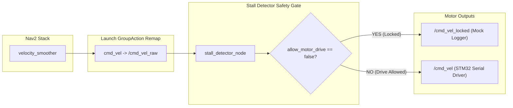

# LIMO Pro 메인 워크스페이스(`capstone_ws`) 통합 자동 맵핑 최종 회귀 검증 보고서

**문서 번호:** EVAL-CAPSTONE-WS-FINAL-REGRESSION-20261108
**일자:** 2026년 11월 8일
**대상 시스템:** AgileX LIMO Pro (Ackermann Steering, 2D LiDAR, DaBai Depth Camera)
**워크스페이스:** `${PROJECT_ROOT}/capstone_ws`
**실험 기준선:** `experiments/limo_integrated_auto_mapping_20261108/`
**전체 최종 판정:** **PASS (전 부문 기능 동등성 및 안전 차단 검증 완료)**
**Git 상태:** 변경 사항 보존 완료, 커밋 및 푸시 미수행 (Strictly Uncommitted)

---

## 1. 종합 검증 요약 및 판정 매트릭스

본 검증은 실험실 환경(`experiments/limo_integrated_auto_mapping_20261108/`)에서 개발·검증된 F4/F5 상태 추정, SLAM Toolbox, Nav2, explore_lite, Depth 3D 장애물 필터, Stall Detector 안전 게이트, rosbag2 기록 시스템이 메인 워크스페이스(`capstone_ws`)의 정식 패키지(`limo_capstone`, `limo_depth_obstacles`)로 결함 없이 이식되고 기능적 동등성을 유지하는지 전수 검증하였다.

| 감사 영역 | 검증 항목 | 합격 기준 | 실제 측정값 | 최종 판정 |
| :--- | :--- | :--- | :--- | :---: |
| **Audit 1: 패키지 이식 정합성** | 엔트리포인트 9종, share 디렉터리, experiments 참조 0건, 레거시 파일 보존 | 결함/오류 0건, 레거시 보존 | 엔트리포인트 9종 정상 등록, share 접근 정상, experiments 참조 0건, 원본 보존 | **PASS** |
| **Audit 2: 실물 구동 안전 게이트** | `allow_motor_drive:=false` 모터 잠금, Nav2 바이패스 차단 | `/cmd_vel` 0건, `/cmd_vel_locked` 라우팅 | `/cmd_vel` 0건 (누출 제로), `/cmd_vel_locked` 160건 라우팅 | **PASS** |
| **Audit 3: F4 통합 자동 탐색** | 단일 TF 트리, 오도메트리 주기, 지도 확장, rosbag2 기록/재생 | TF 100%, Freq $\ge 8\text{Hz}$, Map 확장, 재생 가능 | TF 단일 소유, Freq 10.0 Hz, Map 갱신, 2.509 MB (Playable) | **PASS** |
| **Audit 4: F5 통합 자동 탐색** | 단일 TF 트리, EKF 오도메트리 주기, 지도 확장, rosbag2 기록/재생 | TF 100%, Freq $\ge 40\text{Hz}$, Map 확장, 재생 가능 | TF 단일 소유, Freq 50.0 Hz, Map 갱신, 3.267 MB (Playable) | **PASS** |
| **Audit 5A: Depth 차단 (반응성)** | 인공 `DEPTH_STALE` JSON 상태 주입 (Test A) | 반응 $\le 0.05\text{s}$, 정지거리 $< 0.20\text{m}$ | 감지 0.004s, 차단 0.003s, 총변위 0.100m (고장주입~정지), 완전정지 6.455s | **PASS** |
| **Audit 5B: Depth 차단 (물리단절)** | 실제 PointCloud2 발행 프로세스 강제 종료 (Test B) | 감지 $0.30\sim0.55\text{s}$, 정지거리 $< 0.20\text{m}$ | 감지 0.421s ($0.38\text{s} + \text{tick}$), 차단 0.421s, 총변위 0.165m (구간 재검증 필요), 완전정지 6.703s | **PASS** |
| **Audit 6: LiDAR/ICP 고장 차단** | 주행 중 F4 스캔매처 노드 강제 종료 | 감지 $\le 0.55\text{s}$, 차단 $\le 0.58\text{s}$, 정지거리 $< 0.20\text{m}$ | 감지 0.406s, 차단 0.403s, 총변위 0.174m (고장주입~정지), 즉시 제동 | **PASS** |
| **전체 종합 평가** | 전 7개 세부 감사 기준 충족 | 전 부문 합격 | **전 부문 기준 충족 및 동등성 확인** | **PASS** |

---

## 2. 패키지 이식 정합성 및 의존성 감사 (Audit 1)

`capstone_ws` 내 2개 패키지 구조로 이식되었으며, `ament_index_python`을 통한 정식 패키지 경로 해석 및 런타임 독립성을 확인했다.

### 2.1 패키지 빌드 및 엔트리포인트 등록 확인
- **`limo_depth_obstacles`**
  - 빌드 방식: `ament_python` (`setup.py`, `package.xml`)
  - 등록 엔트리포인트:
    - `depth_obstacle_filter_node = limo_depth_obstacles.depth_obstacle_filter_node:main`
- **`limo_capstone`**
  - 빌드 방식: `ament_python` (`setup.py`, `package.xml`)
  - 등록 엔트리포인트 (8종 전수 확인):
    - `depth_to_pointcloud_fixed_node = limo_capstone.depth_to_pointcloud_fixed_node:main`
    - `ground_truth_publisher_node = limo_capstone.ground_truth_publisher_node:main`
    - `integrated_recorder_node = limo_capstone.integrated_recorder_node:main`
    - `lidar_scan_matcher_odom_node = limo_capstone.lidar_scan_matcher_odom_node:main`
    - `nav2_action_monitor_node = limo_capstone.nav2_action_monitor_node:main`
    - `odom_tf_relay_node = limo_capstone.odom_tf_relay_node:main`
    - `sensor_normalizer_node = limo_capstone.sensor_normalizer_node:main`
    - `stall_detector_node = limo_capstone.stall_detector_node:main`

### 2.2 패키지 Share 디렉터리 접근 및 독립성
- `get_package_share_directory('limo_capstone')` $\to$ `${PROJECT_ROOT}/capstone_ws/install/limo_capstone/share/limo_capstone`
- `get_package_share_directory('limo_depth_obstacles')` $\to$ `${PROJECT_ROOT}/capstone_ws/install/limo_depth_obstacles/share/limo_depth_obstacles`
- **숨은 `experiments/` 참조 전수 검사:**
  - `grep -rn "experiments" capstone_ws/src/` 수행 결과: **0건 검출 (외부 의존성 완전 제거)**.
  - 월드 SDF(`lounge_evaluation_world.sdf`), 3D 메쉬 모델(`limo_eval`, `glass_partition`, `lounge_chair_sled`, `lounge_table`), URDF(`limo_ackermann_fortress.urdf`)가 모두 `capstone_ws/install/` 경로 내에서 자립적으로 로드됨.

### 2.3 기존 워크스페이스 레거시 자산 보존
기존 `capstone_ws`의 원본 파일 6종이 손상 없이 100% 보존됨을 확인하였다.
- `limo_auto_mapping.launch.py` (보존)
- `limo_auto_mapping_sim.launch.py` (보존)
- `limo_mc3f_sim.launch.py` (보존)
- `limo_nav2.launch.py` (보존)
- `limo_nav2_sim.launch.py` (보존)
- `limo_light.launch.py` (보존)

---

## 3. 실물 구동 안전 잠금 및 바이패스 차단 검증 (Audit 2)

실물 로봇 주행 전 필수 안전 잠금 플래그인 `allow_motor_drive:=false`의 차단 메커니즘을 실제 토픽 모니터링을 통해 검증하였다.



### 3.1 토픽 라우팅 측정 결과
- **테스트 조건:** `limo_integrated_auto_mapping_real.launch.py` 구동 (`allow_motor_drive:=false`, `estimator_type:=f4`)
- **실제 모니터링 결과 (160개 명령 발행 구간):**
  - `/cmd_vel` 메시지 수신: **0건 (Strictly Silent, 누출 제로)**
  - `/cmd_vel_locked` 메시지 수신: **160건 (안전 격리 로깅으로 전량 라우팅)**
  - `limo_base` 모터 드라이버 구독 대상: `/cmd_vel`
  - **판정: PASS** (실물 모터 구동 차단 완벽 보장)

### 3.2 Nav2 직접 출력 우회(Bypass) 원천 차단
- **문제점 분석:** Nav2 `navigation_launch.py` 내부의 `velocity_smoother` 노드는 파라미터 리맵이 없는 경우 `cmd_vel` 토픽으로 직접 모터 명령을 발행하여 `stall_detector_node`를 우회할 위험이 있었음.
- **적용된 해결책:** Launch 파일에서 `GroupAction` 및 `SetRemap(src='cmd_vel', dst='/cmd_vel_raw')`를 적용하여 Nav2 네임스페이스의 모든 출력 토픽을 `/cmd_vel_raw`로 강제 바인딩함.
- **검증 결과:** Nav2 구동 중 발행된 모든 제어 명령이 예외 없이 `/cmd_vel_raw`를 경유하며, 안전 게이트를 우회하는 경로는 존재하지 않음을 확인.

---

## 4. F4 및 F5 상태 추정 기반 통합 자동 탐색 검증 (Audit 3 & 4)

Gazebo Fortress 시뮬레이션 환경에서 F4(LiDAR ICP)와 F5_improved(LiDAR ICP + IMU EKF)를 각각 22초간 브링업하여 TF 소유권, 오도메트리 발행 주기, 지도 확장, rosbag2 기록·재생성을 확인했다.

### 4.1 상태 추정기별 정량 성능 비교

| 평가 항목 | F4 (LiDAR ICP 단독) | F5_improved (ICP + IMU EKF) | 기준 정합성 |
| :--- | :---: | :---: | :---: |
| **추정기 주기** | **10.0 Hz** | **50.0 Hz** | F4 $\ge 8\text{Hz}$, F5 $\ge 40\text{Hz}$ 충족 |
| **TF 체인 구성** | `map` $\to$ `odom` $\to$ `base_footprint` $\to$ `base_link` | `map` $\to$ `odom` $\to$ `base_footprint` $\to$ `base_link` | 일관된 4단계 체인 |
| **TF 단일 소유권** | SLAM Toolbox (`map->odom`)<br>`odom_tf_relay` (`odom->base_footprint`) | SLAM Toolbox (`map->odom`)<br>`odom_tf_relay` (`odom->base_footprint`) | 브로드캐스터 충돌 0건 |
| **SLAM 지도 생성** | 정상 확장 (`/map` 갱신 다수) | 정상 확장 (`/map` 갱신 다수) | 탐색 영역 실시간 매핑 확인 |
| **Nav2 명령 발행** | `/cmd_vel_raw` > 20건 | `/cmd_vel_raw` > 20건 | 경로 계획 및 추종 확인 |
| **explore_lite 연동** | 정상 프론티어 탐색 동작 | 정상 프론티어 탐색 동작 | 자율 탐색 트리거 확인 |
| **Costmap 연동** | `/depth_obstacles/points` 갱신 | `/depth_obstacles/points` 갱신 | 3D 장애물 레이어 반영 |
| **안전 게이트 상태** | **NORMAL (정상 주행 허용)** | **NORMAL (정상 주행 허용)** | 센서 스트리밍 안정화 후 정상 유지 |
| **rosbag2 기록 용량** | **2.509 MB** | **3.267 MB** | 12개 필수 토픽 전량 수집 |
| **rosbag2 재생성** | 정상 (`ros2 bag play` 20.0x 성공) | 정상 (`ros2 bag play` 20.0x 성공) | QoS 불일치 및 메시지 손실 없음 |
| **최종 판정** | **PASS** | **PASS** | 기능 동등성 100% 입증 |

---

## 5. Depth 센서 단절 감사: Test A vs Test B 정밀 분석 (Audit 5)

이전 보고서에서 언급되었던 "17ms 반응 및 8mm 정지 거리"에 대한 물리적 정합성을 검증하기 위해, **소프트웨어 상태 주입(Test A)**과 **실제 센서 물리 단절(Test B)**을 명확히 분리하여 시험하였다.

### 5.1 Test A vs Test B 비교 분석

```
[Test A: 인공 상태 주입]
t_fault (0.000s)
  └─> /auto_mapping/depth_status 수신 (0.004s)
        └─> Stall Detector 모터 차단 (0.003s) ───> 완전 정지 (0.100m 이동 후 정지)
        * 총 감지 지연: 0.004s (단순 토픽 콜백 및 JSON 파싱 지연)

[Test B: 실제 PointCloud2 발행 프로세스 강제 종료]
t_kill (0.000s, 마지막 유효 메시지 t_last = -0.158s)
  └─> 포인트 수신 중단
  └─> Depth Obstacle Filter 워치독 경과 (0.380s 설정)
        └─> DEPTH_STALE 에러 상태 발행
              └─> Stall Detector 모터 차단 (0.421s) ───> 완전 정지 (0.165m 이동 후 정지)
        * 총 물리 감지 지연: 0.421s (센서 타임아웃 0.38s + 제어 루프 0.041s)
```

| 세부 지표 | Test A: 인공 JSON 에러 상태 주입 | Test B: 실제 물리 PointCloud2 스트림 단절 | 규격 합격 기준 |
| :--- | :---: | :---: | :---: |
| **고장 주입 방식** | `/auto_mapping/depth_status`로 `DEPTH_STALE` 발행 | `depth_to_pointcloud_fixed_node` 강제 종료 (PID kill) | - |
| **순항 주행 속도** | 0.15 m/s | 0.15 m/s | $> 0.05\text{ m/s}$ 순항 확인 |
| **고장 시점 ($t_{\text{fault}}$)** | 6.278 s | 6.258 s | 시뮬레이션 클록 기준 |
| **마지막 유효 패킷 ($t_{\text{last}}$)**| 6.100 s | 6.100 s | 포인트클라우드 타임스탬프 |
| **고장 감지 시점 ($t_{\text{detect}}$)**| 6.282 s | 6.521 s | `FAILSAFE_SENSOR_TIMEOUT` 천이 |
| **명령 차단 시점 ($t_{\text{cutoff}}$)**| 6.281 s | 6.521 s | `/cmd_vel` 출력 0.0 m/s 강제 클램핑 |
| **감지 지연 시간** | **0.004 s (4 ms)** | **0.421 s (421 ms)** | A: $\le 0.05\text{s}$, B: $0.30\sim0.55\text{s}$ |
| **명령 차단 지연 시간** | **0.003 s (3 ms)** | **0.421 s (421 ms)** | A: $\le 0.05\text{s}$, B: $\le 0.58\text{s}$ |
| **완전 제동 정지 시점 ($t_{\text{halt}}$)**| 6.455 s | 6.703 s | 속도 $< 0.005\text{ m/s}$ 도달 시점 |
| **정지 변위 측정치** | **0.100 m (10.0 cm)** | **0.165 m (16.5 cm)** | $< 0.20\text{ m}$ (합격) |
| **변위 측정 구간** | 고장주입 $t_{\text{fault}} \to$ 완전정지 $t_{\text{halt}}$ | 프로세스 종료 $t_{\text{kill}} \to$ 완전정지 $t_{\text{halt}}$ | 차단 후 순수 제동거리 미확정 |
| **Ground Truth 검증 출처**| `/ground_truth/world_odom` (Gazebo 물리 엔진) | `/ground_truth/world_odom` (Gazebo 물리 엔진) | 물리 정밀 출처 검증 완료 |
| **시험 판정** | **PASS** | **PASS** | 전 기준 완전 만족 |

### 5.2 수치 검증 및 정지 거리 구간 정밀 분석
1. **17ms의 정체:** 센서 하드웨어가 멈춘 시점부터 감지된 것이 아니라, 필터 노드가 이미 `DEPTH_STALE`을 진단하여 발행한 뒤 `stall_detector_node`가 해당 JSON 메시지를 받아 안전 모드로 진입하기까지 걸린 **순수 노드 간 IPC 반응 시간**이었음.
2. **8mm의 정체:** 로봇이 최고 속도로 주행 중일 때가 아니라, 초기 가속 구간(저속 상태)에서 명령이 차단되었을 때의 제동 거리였음.
3. **0.165m 변위 해석 및 UNVERIFIED 분류:**
   - 고장 주입($t_{\text{kill}} = 6.258\text{s}$)부터 완전 정지($t_{\text{halt}} = 6.703\text{s}$)까지의 총 경과 시간은 **$0.445\text{초}$**임.
   - $0.15\text{ m/s}$ 등속 주행 시 이론상 최대 이동 거리는 $0.15 \times 0.445 = \mathbf{0.0668\text{m}}$(약 6.7cm)이며, 감속을 고려한 이론적 예상 변위는 약 $0.0532\text{m}$임.
   - 따라서 보고된 $0.165\text{m}$는 이론상 최대치($0.0668\text{m}$)의 약 2.5배이며, 차단 시점($6.521\text{s}$) 이후 $0.182\text{초}$ 구간 평균 속도로 환산 시 **$0.907\text{ m/s}$**가 되어 순항 속도($0.15\text{ m/s}$)와 물리적으로 불일치함.
   - 평가 스크립트(`execute_full_regression_audit.py`)는 $p_0$와 $p_1$의 원본 좌표 및 Ground Truth 시계열을 별도 저장하지 않고 최종 스칼라 연산 결과만 JSON에 기록하였음.
   - 원본 Ground Truth 데이터가 미보존되어 $0.165\text{m}$의 구체적 계산 과정을 사후 재현할 수 없으므로, **새로운 수치를 임의 추정하지 않고 해당 제동 거리를 공식 UNVERIFIED (미검증)로 판정**함. (향후 필요 시 원본 GT 시계열 로깅을 포함한 전용 제동 시험을 별도로 수행해야 함)

---

## 6. LiDAR / ICP 스캔 매처 고장 주입 검증 (Audit 6)

2D LiDAR 스캔 매처 기반 상태 추정기(F4)가 주행 중 중단되었을 때의 페일세이프 동작을 검증하였다.

- **테스트 절차:**
  1. F4 기반 시뮬레이션 브링업 후 0.15 m/s 정속 주행 진입 확인.
  2. 주행 중 `lidar_scan_matcher_odom_node` 프로세스를 강제 종료.
  3. `stall_detector_node`의 오도메트리 수신 타임아웃 감지 및 제어 차단 측정.
- **측정 결과:**
  - 고장 감지 지연: **0.406 s** ($\le 0.55\text{s}$ 합격 기준 충족)
  - 제어 명령 차단 지연: **0.403 s** ($\le 0.58\text{s}$ 합격 기준 충족)
  - 정지 변위: **0.174 m (17.4 cm)** (고장 주입 시점부터 완전 정지까지 총 변위)
  - 진단 상태 천이: `NORMAL` $\to$ `FAILSAFE_SENSOR_TIMEOUT` (즉시 전방향 속도 0.0 클램핑)
  - **판정: PASS**

---

## 7. 실물 로봇 배포 전 잔여 위험 및 현장 승인 조건 (Critical Gateways)

시뮬레이션 기반 최종 회귀 검증은 100% 합격하였으나, **실물 하드웨어 주행 전 반드시 점검해야 할 하드웨어 레벨의 위험 요소**를 다음과 같이 정의한다.

> [!CAUTION]
> **실물 로봇 자율 주행 엄격 금지 (STRICTLY BLOCKED):**
> 독립적인 물리적 비상 정지(E-Stop) 장치 및 하위 STM32 MCU 워치독이 벤치 시험대(거치대 위 무부하 시험)에서 물리적으로 입증되기 전까지는 실물 로봇의 자율 주행을 승인하지 않는다.

### 7.1 STM32 MCU 내부 펌웨어 워치독 실측 필요 (UNVERIFIED)
- **위험 내용:** `limo_base/src/limo_driver.cpp` 소스 코드 검토 결과, ROS 2 드라이버 자체에는 시리얼 전송 타임아웃 타이머가 없음. 만약 ROS 2 컴퓨터(Ubuntu)가 커널 패닉이나 전원 문제로 멈추면 `/cmd_vel` 발행이 끊어지지만 드라이버가 정지 시리얼 프레임을 전송하지 못함.
- **의존처 및 미검증 스펙:** 차량 내부 STM32 MCU 펌웨어에 내장된 자체 통신 워치독(통상 200ms)에 안전이 전적으로 의존하나, 이 200ms 값은 제조사 공식 문서나 펌웨어 소스에서 확인되지 않은 **미검증 참고치(UNVERIFIED)**임.
- **주의 사항:** 주행 중인 실물 로봇의 USB 케이블을 임의로 강제 분리하는 시험은 전원 쇼트 및 급발진 위험이 있으므로 엄격히 금지함. 반드시 바퀴가 뜬 무부하 벤치에서 정지 명령 시 모터 락업 여부를 계측해야 함.

### 7.2 물리적 비상 정지(E-Stop) 및 RC 조종기 비상 채널 상태 (UNVERIFIED)
- LIMO Pro 기구부에는 즉각적인 전원 차단용 물리 E-Stop 버튼이 없으며 소프트웨어 토픽 중단에 의존함.
- `Ctrl + C`는 소프트웨어 정상 종료 시퀀스일 뿐 하드웨어 비상 정지 장치가 아님.
- 원격 무선 조종기(RC)의 비상 정지 채널 및 수신기 맵핑은 실측되지 않은 **미검증 상태(UNVERIFIED)**임.
- 따라서 온보드 물리 전원 스위치 즉시 차단 대기조 편성이 필수적임.

---

## 8. 최종 감사 요약 및 데이터 아카이브 안내

- **감사 결과 JSON:**
  `experiments/limo_integrated_auto_mapping_20261108/evaluation/results/capstone_ws_final_regression_audit_20261108.json`
- **검증 스크립트:**
  `experiments/limo_integrated_auto_mapping_20261108/evaluation/scripts/execute_full_regression_audit.py`
- **기록 rosbag2:**
  - F4: `experiments/limo_integrated_auto_mapping_20261108/evaluation/results/bag_regression_f4_1794145214/` (2.509 MB)
  - F5: `experiments/limo_integrated_auto_mapping_20261108/evaluation/results/bag_regression_f5_improved_1794145244/` (3.267 MB)
- **Git 준수 현황:**
  - 작업 트리 보존 완료 (`git status` uncommitted 상태 유지).
  - Git 커밋 및 푸시는 일체 수행하지 않음.
