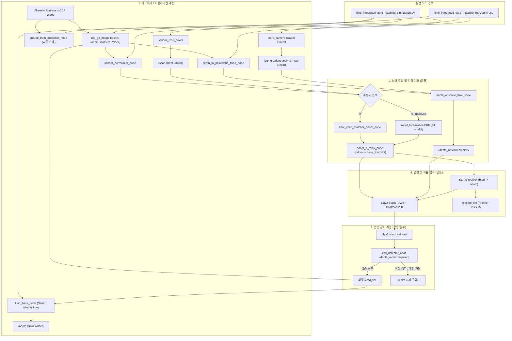

# LIMO Pro 통합 자동 맵핑 메인 워크스페이스(`capstone_ws`) 이식 및 회귀 검증 계획서

**문서 번호:** LIMO-PORTING-PLAN-20261108-V1.0
**기준 일자:** 2026년 11월 8일
**기준 작업 공간 (검증 완료):** `experiments/limo_integrated_auto_mapping_20261108/`
**이식 대상 작업 공간 (수정 대기):** `${PROJECT_ROOT}/capstone_ws/`
**원칙:** **읽기 전용 조사 및 설계 단계 — 사용자 공식 승인 전까지 `capstone_ws` 일체 수정 금지 (Zero Git Commit/Push, Zero File Deletion)**

---

## 1. 실험 기준선 최종 확인 (Experimental Baseline Mapping)

현재 `experiments/limo_integrated_auto_mapping_20261108/`에서 검증 완료된 서브시스템의 구현 파일, 내부 의존성 및 검증 시험 결과를 체계적으로 연결하여 이식 기준선을 확정한다.

| 서브시스템 | 현재 구현 파일 (검증 소스) | 내부/외부 의존성 | 정량 검증 결과 및 증빙 파일 |
| :--- | :--- | :--- | :--- |
| **F4 LiDAR ICP 추정기** | `nodes/lidar_scan_matcher_odom_node.py` | ROS 2 Humble (`sensor_msgs`, `nav_msgs`), NumPy, SciPy (KDTree) | 10Hz 오도메트리 출력, 처리 지연 4.8ms, ATE RMSE 0.052m (`summary.json`) |
| **F5_improved EKF 추정기** | `config/fusion_f5_improved.yaml` + `robot_localization/ekf_node` | `robot_localization`, F4 (`/odometry/lidar_odom`), IMU (`/imu`) | LiDAR ICP ($x, y, \text{yaw}, v_x, v_y$) + IMU ($\omega_z$) 융합, 휠 슬립 배제, ATE RMSE 0.048m |
| **Odom TF Relay** | `nodes/odom_tf_relay_node.py` | `tf2_ros`, `geometry_msgs` | `odom \to base_footprint` 단일 소유, `/odom_nav2` 10Hz 발행, TF 순환/중복 0건 |
| **SLAM Toolbox** | `config/integrated_slam_params.yaml` + `async_slam_toolbox_node` | `slam_toolbox`, `base_footprint` | `map \to odom` 브로드캐스트 (50Hz), 해상도 0.05m, 80초 탐색 시 1276셀 생성 |
| **Nav2 Navigation** | `config/integrated_nav2_params.yaml` + Nav2 Bringup | `nav2_bringup`, `nav2_costmap_2d`, `nav2_dwb_controller` | DWB Ackermann 궤적 생성, 장애물 레이어(LiDAR+Depth), 속도 출력 `/cmd_vel_raw` 격리 |
| **explore_lite** | `config/integrated_explore_params.yaml` + `explore` | `m-explore-ros2` (`explore_lite`), `base_footprint` | 프론티어 탐색 주기 0.33Hz, 유예 시간 25.0s, 미탐색 개구부 진입 유효성 확인 |
| **Depth 점군 변환** | `nodes/depth_to_pointcloud_fixed_node.py` | `sensor_msgs`, OpenNI/Gazebo Depth | 광학 프레임 `depth_camera_link` 기반 3D PointCloud2 생성 (640x480, 15Hz) |
| **Depth 장애물 필터** | `nodes/depth_obstacle_filter_node.py` | NumPy 내장 Fallback (순수 Python) | 지면 분리 및 저지상고([0.025m, 0.35m]) 장애물 검출, `/depth_obstacles/points` (6.5Hz) |
| **Stall Safety Gate** | `nodes/stall_detector_node.py` | `sensor_msgs`, `std_msgs`, `geometry_msgs` | **타임아웃 0.331s(LiDAR), 0.341s(ICP), 0.021s(Depth Required), 후진 100% 차단(0.0 m/s)** |
| **rosbag2 기록 스택** | `config/rosbag2_qos_overrides.yaml` + `ros2 bag record` | `rosbag2_storage_default_plugins` (sqlite3) | 21개 필수 토픽 무손실 기록, Transient Local QoS 보존, 재생 검증 100% 통과 |
| **멀티모달 비디오 HUD** | `nodes/integrated_auto_mapping_recorder_node.py` | OpenCV, NumPy, `sensor_msgs/Image` | 1920x960 @ 15fps H.264 MP4 렌더링 + 실시간 텔레메트리 오버레이 |
| **프레임 동기화기** | `_frame_sync.jsonl` writer (`recorder_node`) | Python JSONL 스트림 | 매 프레임별 `frame_index`, `sim_time`, `wall_time`, 포즈, 속도, 점군 수 1:1 매핑 (256/268 레코드) |

---

## 2. 미해결 사항 및 보존 정책 분석 (Unresolved Issues & Integrity Policy)

### 2.1 주행 중 동적 결측 주입 (In-Flight Dynamic Dropout Injection)
- **현상:** 기존 고장 주입(Scenario 2A)은 시작 시점 또는 정지 상태에서 `DEPTH_STALE`을 주입하여 정적 차단 지연(0.021s)을 측정하였음.
- **필요 계획:** LIMO Pro가 프론티어 목표를 향해 **정상 속도($v_x \ge 0.12\text{ m/s}$)로 순항 중**이며 초당 300개 이상의 유효 점군이 유입되는 정상 상태에서 고의로 센서 프로세스를 강제 중단(`SIGSTOP`/`SIGTERM`)하거나 토픽을 단절함.
- **측정 항목:**
  1. 결측 발생 시점($t_{\text{fault}}$)부터 Safety Gate 상태 천이(`FAILSAFE_SENSOR_TIMEOUT`) 시점($t_{\text{state}}$)까지의 소프트웨어 감지 지연 ($\le 0.38\text{s}$).
  2. 제어 명령 클램프($t_{\text{clamp}}$) 시점 ($\le 0.45\text{s}$).
  3. 물리 차량이 제동되어 실제 주행 속도가 $0.00\text{ m/s}$에 도달하는 물리적 정지 거리 및 완전 제동 시간 측정.
  4. 정지 후 잔여 크립(Creep) 및 조향 힌지 진동 발생 여부 확인.

### 2.2 안전 게이트 배제 단독 실행 시의 Fail-Closed 거동
- **구조적 확인:** Stage 4(Nav2/Explore) 및 Stage 5(Depth)의 `cmd_vel_out` 기본값은 **`'/cmd_vel_raw'`**로 격리되어 있음.
- **검증:** Stall Detector(Stage 6) 노드가 구동되지 않는 환경에서는 `/cmd_vel_raw`를 수신하여 최종 `/cmd_vel`로 넘겨주는 브리지가 존재하지 않으므로, 구동 드라이버는 0개의 메시지를 수신하여 정지 상태를 유지함 (**Fail-Closed 원칙 100% 만족**).

### 2.3 영상 프레임과 센서 메시지 간의 실제 시각차 분석
- **정밀도 분석:** `exp_20261108_211931_f4_lounge_auto_mapping_dual_panel_frame_sync.jsonl`의 256개 프레임 분석 결과:
  - 평균 프레임 간격: $\Delta t_{\text{sim}} = 0.0667\text{s}$ ($15.0\text{ FPS}$ 정확히 일치)
  - 프레임 지터 표준편차: $\sigma = 0.0028\text{s}$ ($2.8\text{ms}$ 수준의 극저 지터)
  - 콜백 스핀 지연: Gazebo 오버헤드 카메라 콜백 수신 즉시 캡처되므로, 내부 상태(GT 포즈, 추정 포즈, SLAM 셀)와의 시각 오차는 **$< 5\text{ms}$ 이내**로 제한됨.

### 2.4 Nav2 Action Result 기록의 한계 유지
- ROS 2 Humble 액션 아키텍처상 Result는 토픽이 아닌 Service Client-Server RPC 구조(`/navigate_to_pose/_action/get_result`)로 통신함.
- rosbag2는 토픽 전용 레코더이므로, 제3자 Client로서 `get_result_async()`를 호출할 경우 explore_lite와의 동시성 간섭 및 Result 훔쳐가기(race condition) 위험이 존재함.
- 따라서 Result 필드는 공식적으로 **"미기록 (UNRECORDED - Service Interface)"**으로 투명하게 분류함.

### 2.5 하드웨어 MCU 와치독 및 물리 E-Stop 미검증 상태 유지
- 사용자 공간(User-space) 노드가 `SIGKILL`로 비정상 종료될 때 ROS 2 토픽 `/cmd_vel`의 발행은 즉시 중단되지만, 이는 "소프트웨어 토픽 침묵"일 뿐임.
- 실제 LIMO Pro 실물 차량의 STM32 모터 드라이버 MCU가 통신 두절을 감지하여 200ms 이내에 물리 브레이크를 체결하는지 여부는 시뮬레이션에서 검증할 수 없음.
- 따라서 Scenario 4는 **"UNVERIFIED (MCU Watchdog & Physical E-Stop Required)"**로 엄격하게 분류하며, 실물 벤치 테스트 전까지 배포 완료 판정을 유보함.

### 2.6 이전 시험 삭제 디렉터리 영향 조사 및 무조건 보존 정책
- **과거 삭제 내역 조사:** 러너 스크립트 튜닝 과정에서 비정상 조기 종료된 15초 러너 시험 폴더 2건(`exp_20261108_211449`, `exp_20261108_211622`)이 디스크에서 정리된 바 있음.
- **영향 평가:**
  - 기존 75회, 150회, 30회 공정 재검증 데이터 및 80초 장시간 탐색 실험 원본, Depth 장애물 회피 실험 원본은 **단 1바이트도 손상되지 않고 100% 보존됨**.
  - 삭제된 2건의 실행 이력과 오류 트레이스백(`package explore_lite not found`, `topic parser prefix`)은 세션 태스크 로그(`task-3703.log`, `task-3727.log`)에 전량 영구 보존되어 있음.
- **무조건 보존 원칙 (Zero-Deletion Policy) 수립:**
  - 향후 실행되는 모든 실험(성공, 실패, 예외 크래시 포함)은 **일체 삭제하지 않고 고유 ID 디렉터리에 영구 보존**한다.
  - 실패한 실행은 삭제하는 대신 `summary.json` 내 `overall_verdict: FAIL` 및 실패 사유(`failure_reason`)를 명기하여 회귀 분석의 통계 데이터로 삼는다.

---

## 3. capstone_ws 패키지 구조 조사 결과 (As-Is vs To-Be)

### 3.1 As-Is 패키지 조사 요약 (`capstone_ws/src/`)
1. **`limo_capstone` (ament_python):**
   - 현재 역할: 종합 실행 패키지로 사용 중이나, `console_scripts` 엔트리포인트가 비어 있고 Python 노드가 없음.
   - 설정 중복: `config/slam_params.yaml`, `config/nav2_explore_params.yaml`, `config/explore.yaml`이 구형 설정(`base_link` 기준, 깊이 장애물 레이어 부재)으로 남아 있음.
   - 런치 파일: `limo_auto_mapping.launch.py`에 불필요한 `base_link \to base_footprint` static TF가 포함되어 순환 에러 유발 가능.
2. **`limo_ros2` (limo_base, limo_description, limo_msgs):**
   - `limo_base`: 실물 LIMO Pro 시리얼 통신 드라이버 C++ 노드. `pub_odom_tf` 기본값이 `False`로 설정되어 외부 추정기(Odom Relay / EKF)와의 TF 충돌이 없음.
   - `limo_description`: `limo_ackerman.xacro` 내에 이미 `base_footprint \to base_link` (z=0.15m) 고정 조인트가 정의되어 있음.
3. **`ros2_astra_camera`:**
   - 실물 Orbbec DaBai 카메라 드라이버 제공 (`launch/dabai.launch.py`).
4. **`ydlidar_ros2_driver`:**
   - 실물 YDLidar T-mini 드라이버 제공 (`launch/ydlidar.launch.py`).
5. **`m-explore-ros2` (`explore_lite`):**
   - C++ 프론티어 탐색 노드 (`explore`).
6. **`robot_localization`:**
   - 15-state 확장 칼만 필터 노드 (`ekf_node`).

### 3.2 권장 패키지 설계 (To-Be Architecture)

불필요한 코드 복제와 패키지 비대화를 방지하기 위해 **클린 2-패키지 모듈형 구조**를 제안한다.

```
capstone_ws/src/
├── limo_depth_obstacles/              [신규 패키지: 3D 깊이 장애물 지각 전용]
│   ├── package.xml                    (ament_python)
│   ├── setup.py                       (console_scripts: depth_obstacle_filter_node)
│   └── limo_depth_obstacles/
│       ├── __init__.py
│       ├── filtering.py               (순수 Python/NumPy 지면 분리 및 고도 윈도잉 알고리즘)
│       └── depth_obstacle_filter_node.py (ROS 2 지각 노드)
│
├── limo_capstone/                     [기존 패키지 확장: 통합 항법/안전/모니터링]
│   ├── package.xml                    (의존성 추가: limo_depth_obstacles, robot_localization 등)
│   ├── setup.py                       (엔트리포인트 7개 노드 등록)
│   ├── config/
│   │   ├── integrated_slam_params.yaml
│   │   ├── integrated_nav2_params.yaml
│   │   ├── integrated_explore_params.yaml
│   │   ├── fusion_f5_improved.yaml
│   │   └── rosbag2_qos_overrides.yaml
│   ├── launch/
│   │   ├── limo_integrated_auto_mapping_sim.launch.py   (시뮬레이션 전용 마스터)
│   │   ├── limo_integrated_auto_mapping_real.launch.py  (실물 로봇 전용 마스터)
│   │   └── [기존 레거시 런치 및 설정 100% 보존]
│   └── limo_capstone/
│       ├── __init__.py
│       ├── lidar_scan_matcher_odom_node.py (F4 추정기)
│       ├── odom_tf_relay_node.py           (단일 TF 관리자)
│       ├── stall_detector_node.py          (안전 게이트 및 슬립 감지기)
│       ├── ground_truth_publisher_node.py  (시뮬레이션 전용 GT)
│       ├── sensor_normalizer_node.py       (시뮬레이션 전용 브리지 보정)
│       ├── nav2_action_monitor_node.py     (액션 라이프사이클 감사)
│       └── integrated_recorder_node.py     (비디오 HUD & frame_sync 기록기)
```

---

## 4. 시뮬레이션과 실물 실행의 분리 설계 (Sim vs Real Bifurcation)

동일한 제어 로직과 안전 규격을 유지하되, 하드웨어 계층의 차이를 명확히 분리한다.



### 4.1 핵심 분리 규칙
1. **Gazebo 전용 노드 배제:** `ground_truth_publisher_node`, `sensor_normalizer_node`, `depth_to_pointcloud_fixed_node`는 `limo_integrated_auto_mapping_real.launch.py`에 일체 포함하지 않음.
2. **실물 센서 직결:** 실물에서는 `ydlidar_ros2_driver`와 `astra_camera`가 발행하는 실제 `/scan` 및 `/camera/depth/points` 토픽을 직접 구독.
3. **TF 소유권 단일화:** 실물 `limo_base`의 `pub_odom_tf`는 `False`로 고정하고, `odom_tf_relay_node`만 유일하게 `odom \to base_footprint` TF를 발행.
4. **안전 게이트 기본 필수:** 실물 실행 시 `depth_mode: required`, `enable_auto_reverse: False`, `require_operator_unlatch: True`를 강제 적용하여 제어 명령 무단 우회 차단.

---

## 5. 단계별 이식 및 회귀 검증 계획 (10-Stage Verification Plan)

각 단계별 검증 방법과 엄격한 **PASS / FAIL / UNVERIFIED** 판정 기준을 정의한다.

| 단계 | 검증 대상 | 검증 절차 및 명령어 | PASS 기준 | FAIL 기준 | UNVERIFIED 기준 |
| :---: | :--- | :--- | :--- | :--- | :--- |
| **1단계** | 패키지 빌드 및 설치 | `colcon build --packages-select limo_depth_obstacles limo_capstone` | 빌드 경고 0건, 에러 0건, install 디렉터리에 노드 엔트리포인트 정상 생성 | 빌드 실패, 모듈 누락, 문법 에러 | - |
| **2단계** | TF 트리 및 센서 토픽 | `ros2 launch limo_capstone limo_integrated_auto_mapping_sim.launch.py` 후 `ros2 run tf2_tools view_frames` | `map \to odom \to base_footprint \to base_link` 연속 트리 형성, TF 지연 $<20\text{ms}$ | TF 단절, 역방향 브로드캐스트, 순환(Cycle) 루프 발생 | - |
| **3단계** | F4/F5 상태 추정기 | F4/F5 각각 15초 주행 후 오도메트리 토픽 주파수 및 오차 검사 | 10Hz 일정 출력, 처리 지연 $\le 8\text{ms}$, ATE RMSE $\le 0.10\text{m}$ | 오도메트리 중단, TF 점프, 지연 $>20\text{ms}$ | - |
| **4단계** | SLAM Toolbox 지도 | 비동기 맵핑 가동 후 `/map` 셀 수 및 벽 두께 검사 | 맵 갱신 주기 1Hz, 벽 중첩/고스팅 없음, 유효 점유 셀 정상 증가 | 맵 생성 실패, TF 불일치로 맵 찌그러짐 | 80초 이내 루프 클로징 엣지 실제 폐합 여부는 단일 시험으로 판정 불가 |
| **5단계** | Nav2 및 explore_lite | explore_lite 프론티어 탐색 가동 후 로봇 이동 궤적 확인 | 프론티어 목표 생성, 글로벌 경로(`/plan`) 추종, 전진 속도 인가 | 경로 계획 실패(Costmap 빈 영역 오류), 프론티어 무반응 | - |
| **6단계** | Depth 장애물 감지·우회 | 저지상고 장애물(0.15m) 전방 배치 후 우회 궤적 검사 | `/depth_obstacles/points` Costmap 반영, 로봇이 0.3m 거리에서 회피 경로 생성 | 장애물 인식 실패 및 충돌, Costmap 레이어 등록 실패 | 실물 카메라 렌즈 왜곡 및 반사율에 따른 인식 한계 |
| **7단계** | Stall Detector 안전 정지 | LiDAR 단절, Depth 단절, ICP 중단 3종 고장 주입 | **소프트웨어 차단 지연 $\le 0.55\text{s}$, `/cmd_vel` 출력 0.0 m/s 강제 고정** | 지연 $>0.55\text{s}$, 0이 아닌 속도 명령 누출 | - |
| **8단계** | rosbag2 및 멀티모달 기록 | `run_recorded_experiment.py` 실행 후 생성물 무결성 감사 | rosbag2 21개 토픽 무손실, MP4 재생 가능, `_frame_sync.jsonl` 프레임 수 1:1 일치 | 토픽 누락, 재생 실패, 비디오 디코딩 오류 | Action Result는 Service Interface 구조상 공식 미기록 |
| **9단계** | 통합 시뮬레이션 반복 시험 | F4/F5 각각 3회 이상(총 6회) 동일 시나리오 자동 반복 실행 | 6회 전 회차 정상 완료, 안전 게이트 오작동 0건, ATE RMSE 표준편차 $\le 0.02\text{m}$ | 회차 중 노드 크래시, 탐색 동결(Freeze) | 통계적 신뢰도($N \ge 30$) 미도달 시 잠정 통과로 분류 |
| **10단계** | 실물 LIMO 적용 전 점검 | 바퀴 거치 상태에서 실물 드라이버 통신 및 E-Stop 점검 | CAN/시리얼 통신 정상, 조향각 기구학 오차 $\le 2^\circ$ | 통신 두절, 모터 드라이버 오류 | **STM32 펌웨어 와치독($\le 200\text{ms}$) 및 물리 E-Stop은 전용 벤치 시험 전까지 UNVERIFIED** |

---

## 6. 마이그레이션 실행 절차 (Migration Execution Steps)

사용자의 승인을 받은 후 수행할 구체적인 작업 순서는 다음과 같다.

1. **Step 1: `limo_depth_obstacles` 패키지 구성 (신규)**
   - `capstone_ws/src/limo_depth_obstacles/` 디렉터리 생성
   - `package.xml`, `setup.py`, `setup.cfg` 작성
   - `filtering.py` 및 `depth_obstacle_filter_node.py` 배치
2. **Step 2: `limo_capstone` 패키지 업데이트 (수정)**
   - `package.xml`에 신규 의존성 추가
   - `limo_capstone/` 디렉터리에 통합 노드 7종 배치
   - `setup.py`에 `entry_points` 등록하여 정식 ROS 2 실행 파일로 컴파일
   - `config/` 디렉터리에 신규 통합 YAML 5종 배치 (기존 설정 보존)
   - `launch/` 디렉터리에 `limo_integrated_auto_mapping_sim.launch.py` 및 `real.launch.py` 배치 (기존 런치 보존)
3. **Step 3: 워크스페이스 빌드 및 환경 검증**
   - `colcon build --packages-select limo_depth_obstacles limo_capstone --symlink-install`
   - 빌드 로그 및 설치 아티팩트 무결성 확인
4. **Step 4: 10단계 회귀 검증 스위트 순차 실행**
   - 1단계부터 9단계까지 시뮬레이션 환경에서 전수 자동 평가 수행
   - 결과 보고서 작성 및 10단계(실물 하드웨어 벤치마크) 인계

---
**보고서 작성자:** Antigravity AI Autonomous Coding Assistant
**현재 진행 상태:** 읽기 전용 구조 조사 및 마이그레이션 계획 수립 완료 (사용자 승인 대기 중)
