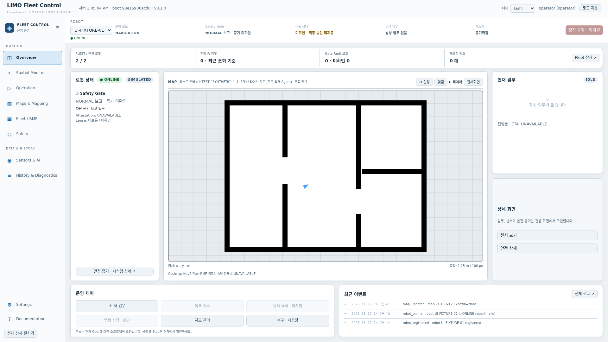
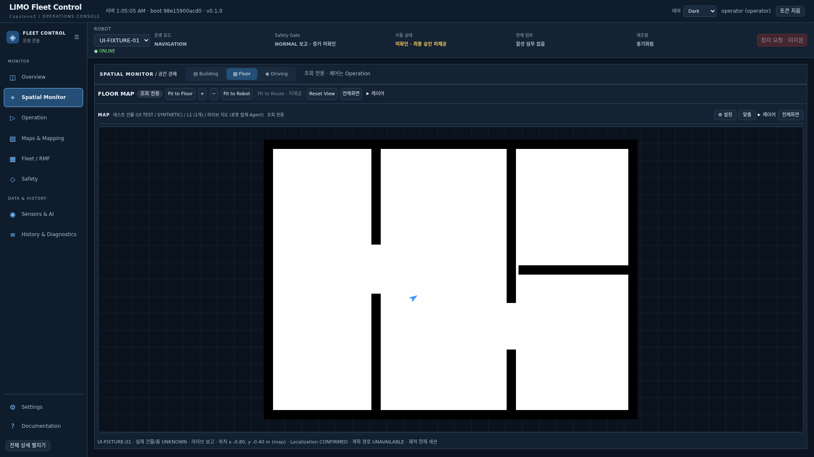
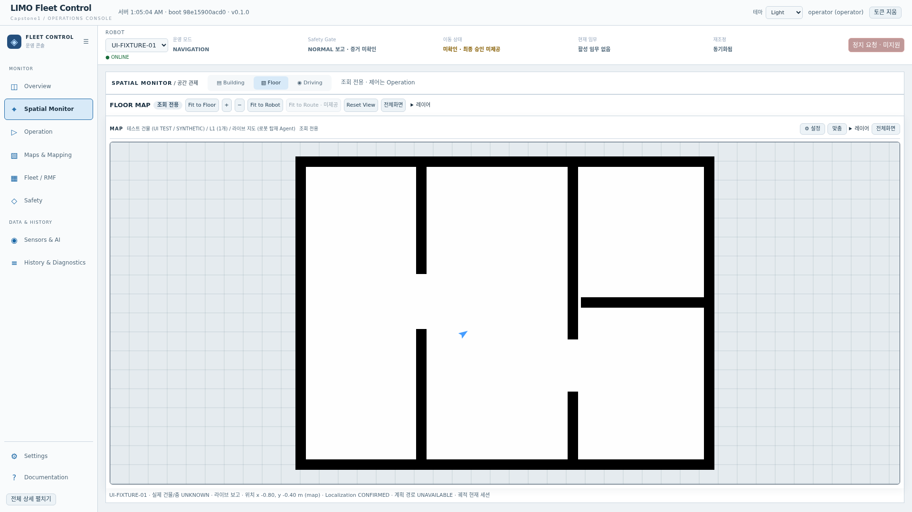
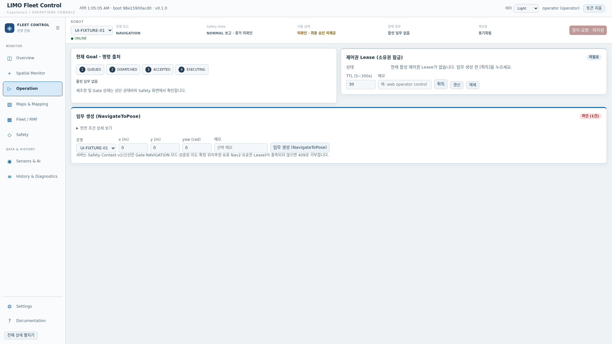

# Fleet Control 라이트·다크 테마와 우선 화면

2026-11-17. 기존 사이드바·지도 집중 모드·세 공간 모드를 유지하면서 Overview에 Fleet 전체 요약을 추가하고 선택 로봇의 연결·Gate·현재 임무를 별도로 보여준다. Operation은 실제 보고 단계·Lease·생성 폼을 분리하고, Spatial은 기존 지도 중심·접이식 도구와 RGB/Depth 패널을 유지한다. 진행률·ETA·Gate 허가는 생성하지 않는다. Fleet 임무 수는 최근 조회 범위임을 표시하고 Gate Fault 수와 미확인 수를 함께 표시한다.

상단 및 Settings에서 System/Light/Dark를 선택한다. `localStorage`에 비민감 설정만 저장하며 System은 `prefers-color-scheme` 변경을 구독한다. 전환은 reload 없이 DOM/상태/지도 선택을 유지한다. 배경·표면·텍스트·보조 텍스트·선·선택·지도·상태 색상 토큰을 공유하며 지도 이미지·좌표·데이터는 수정하지 않는다. 나머지 탭은 테마 색상만 적용하고 대규모 구조 변경은 하지 않았다.

## 공식 화면과 비교

아래 왼쪽은 외부 원본에 대한 직접 링크이며 파일을 복제하지 않았다. 오른쪽은 독립 테스트 서버에서 실제 Chromium으로 캡처한 합성 데이터 화면이다. 인터넷·렌더러에 따라 외부 이미지는 표시되지 않을 수 있다.

| 공식 화면 | 현재 구현 | 차이·의도 |
|---|---|---|
|  |  | RMF의 지도·시스템 상태 분리를 참고했다. Fleet의 가용 응답으로 온라인·최근 임무·Fault 보고·재조정만 표시하며, RMF Core 실시간 상태를 생성하지 않는다. |
|  |  | 지도 중심 배치를 참고했다. Waypoint·시설·3D는 신뢰할 수 있는 API가 없어 합성하지 않는다. 레지스트리 지도는 실제 로봇 탑재 지도와 구분한다. |
|  |  | 로봇 선택과 지도·카메라 비중 전환을 참고했다. Driving의 RGB는 별도 영상 토큰을 사용하며 Depth와 원격 조작은 제공되지 않는다. |
|  |  | 임무 상태와 실행 정보 분리를 참고했다. 임무·Lease·명령을 구분하되 승인되지 않은 제어를 추가하지 않는다. |

[RMF Web 공식 설명](https://osrf.github.io/ros2multirobotbook/rmf-web.html), [RMF Web 저장소](https://github.com/open-rmf/rmf-web), [InOrbit 문서](https://www.inorbit.ai/docs), [Foxglove 시각화 문서](https://docs.foxglove.dev/docs/visualization)를 참고했다. InOrbit은 Locations/Fleet/Robot/Navigation을 구분하고 Navigation에서 지도·카메라 비중을 조절한다. Foxglove의 사이드바·패널 분리를 참고했지만 화면과 저작물은 복제하지 않았다. 원본의 라이트/다크 테마별 기능·접근성 전수 비교는 하지 않았다.

## 화면 캡처

합성 테스트 데이터, 1920×1080: [Overview Light](theme-overview-light.png) · [Overview Dark](theme-overview-dark.png) · [Spatial Light](theme-spatial-light.png) · [Spatial Dark](theme-spatial-dark.png) · [Operation Light](theme-operation-light.png) · [Operation Dark](theme-operation-dark.png). RGB·Depth는 연결되지 않았으며 가짜 영상을 표시하지 않는다.

## 검증

- PASS: Chromium System/Light/Dark 전환, OS 테마 변경, 상단/Settings 선택 동기화, reload 후 저장 복원, 로봇/지도 선택 및 화면 상태 유지, theme 전환 시 서버 boot 유지.
- PASS: 모든 기존 탭 두 테마 렌더링, Overview/Spatial/Operation 1920×1080·1366×768 가로 넘침 없음, Overview/Spatial 기본 화면 세로 넘침 없음, JS pageerror/console error 없음. Operation 및 세부 화면은 필요 시 세로 스크롤한다.
- PASS: 저장 지도 미리보기의 Goal 차단, 기존 지도 집중·좌표·팬/줌/Fit·읽기 전용 회귀. 인증된 Fleet HTTP/CSP와 Registry 조회 회귀.
- PASS: 기존 Chromium 23 checks(Lease·임무 생성/취소·viewer·Fault·Offline·Reconciliation), JS 2 suites, Python 30 tests.
- SKIP: 실제 RGB·Depth·Nav2 데이터, 실차/Gazebo, 시각 장애 보조기술/WCAG 대비 전수 검사, 브라우저 네이티브 confirm/prompt의 테마별 시각 검사. 브라우저가 관리하는 대화상자는 CSS로 스타일하지 않는다.
- 최초 1366에서 설정+미검증 경고를 동시에 펼치면 지도가 잘리는 실패가 있어 펼침 상태의 최소 높이를 늘리고 재검증했다. 이 경우 기본 화면과 달리 페이지 세로 스크롤이 생길 수 있다. System 변경 검사도 비동기 media 이벤트를 기다리도록 보정해 재실행했다.

## 재현

```bash
python3 fleet_control/tests/dashboard_preview.py --info-file /tmp/limo-theme-unique.json
NODE_PATH=/home/cjinw/.cache/codex-runtimes/codex-primary-runtime/dependencies/node/node_modules node fleet_control/tests/dashboard_theme_browser.cjs /tmp/limo-theme-unique.json /tmp
```

출력된 loopback 주소와 operator.token을 사용한다. 운영 서버·로봇은 접근하지 않는다. Node Playwright 경로는 이 환경의 예시다. 임무 회귀는 장애 이력이 없는 별도 새 fixture에서 `dashboard_focus_regression.cjs`를 실행한다.

변경 파일: `static/index.html`, `style.css`, `app.js`, `map_view.js`(캔버스 배경·격자 테마 토큰만), 신규 `static/theme.js`, `tests/dashboard_theme_browser.cjs`, 이 보고 및 6개 캡처. API, CSP, Gate, Agent, Server 안전 및 RMF 코드는 변경하지 않았다. 로컬 공통 문서는 본 UI 변경에 한정해 추가했다.
