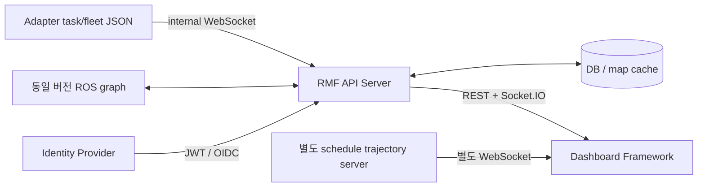

# API 통신 구조와 Office 연동 계획 — 아직 미연결

## 공식 current main 구조

소스 기준 API Server는 FastAPI/FastIO+Socket.IO이며 Tortoise ORM/DB와 지도이미지cache를 관리합니다. ROS 메시지의 이미지 bytes는 API에서 URL로 바뀝니다. Adapter의 task/fleet/log JSON 유입은 `routes/internal.py`의 WebSocket이며 public GET과 역할이 다릅니다. main README의 server_uri HTTP 표기만 보고 프로토콜이 확정됐다고 판단하지 않습니다. 실제 선택한 버전의 source/launch를 맞춥니다. 별도 trajectory server는 RMF API Server의 fleet 경로조회와 동일하지 않습니다.

이번 Storybook은 MockRmfApi의 Subject/BehaviorSubject와 요청을 거부하는 axios adapter를 사용합니다. API Server·IDP·trajectory WebSocket을 실행하지 않았습니다. 공식 FakeTrajectoryManager의 trajectory JSON을 로컬 재생할 뿐입니다.

## 읽기 API 계약 — source c1b13dc 기준, HTTP runtime 미검증

|공식 인터페이스|응답/용도|자체 UI 연결|
|---|---|---|
|GET `/building_map` + 동일room 구독|BuildingMap,levels/images/nav_graphs|층별배경 raster/vector·revision,OccupancyGrid와구분|
|GET `/fleets`|FleetState[]|fleet 목록·로봇목록|
|GET `/fleets/{name}/state` + 구독|robots dictionary,location/status/battery/task_id|robot scoped read model|
|GET `/fleets/{name}/log` + 구독|FleetLog|robot issue·최근상태로그|
|GET `/tasks`, `/tasks/{id}/state` + state 구독|TaskState,booking/status/phases/assigned_to/estimates|임무표·단계·예상진행·이력|
|GET `/tasks/{id}/log` + 구독|TaskEventLog|임무별phase/event logs|
|GET `/user`, `/permissions`|identity/권한 관측|자체viewer정책과매핑하되명령권한승격금지|
|GET/subscribe alerts 관련경로|AlertRequest/Response|경고읽기만;응답/ack API 도입은별도설계|
|별도 trajectory WS|request=trajectory,param={map_name,duration,trim}; values/conflicts|RMF교통계획 읽기레이어|

정확한 alert route 세부명·query·models는 선택버전 OpenAPI로 확정해야 합니다. HTTP Bearer/JWT,Socket.IO connect auth token,subscribe event와{room:path}는 api-client와FastIO source를같이사용해맞춥니다. 일반WebSocket클라이언트로Socket.IO프로토콜을대체하지않습니다. UI기본포트5173,API8000,trajectory8006은공식예시이며이번에는18410만사용했습니다.

`/_internal`은임무제출용브라우저API가아니고Adapter상태유입용입니다. 자체MM`/api/v1/...`및lab`/api/state`와공식root`/fleets`,`/tasks`는경로·schema·인증이모두다릅니다. URL만바꿔대체할수없습니다. Snapshot normalizer를두고기존MM/Robot Agent를유지합니다.

## 최소 연결 변경

1. 기존 `dashboard_lab/docs/OFFICE_INTEGRATION.md`의 observer→private snapshot→OfficeReadModel 설계를 유지합니다. 이 연구는그구현을진행하지않았습니다.
2. Office가발행하는RMF JSON/ROS type과실제선택버전schema를대조합니다. nativeHumble라면Humble브랜치/설치schema를우선사용합니다. 최신main형식으로Humble유입값을무조건검증하지않습니다.
3. 선택적으로공식API가준비되면`read-only RmfApiClient`에서building/fleets/tasks/log만GET/구독하고자체`/api/state`형식으로변환합니다. browser에는기존viewer session만노출하고RMF상위credential은backend private파일로관리합니다. 명령POST·task dispatch·cancel·decommission은허용하지않습니다.
4. task ID는origin/run/original booking.id로관리하고Mission Manager mission_id와correlation이있을때만연결합니다. command ID와booking ID를같다고가정하지않습니다. status 원문·source를보존하고dispatch finished를task completed로변환하지않습니다.
5. robot identity는(fleet,robot)+run/boot,render frame은building/level/map revision으로묶습니다. ROS frame_id를임의로바꾸거나다른fleet의동명robot을합치지않습니다. Location에는Header가없는경우가있어level 좌표를별도등록합니다.
6. ROS_SIM/UNIX/REPLAY 시간은구분하고원본stamp_ns를문자열로유지합니다. 수신freshness는monotonic,sim pause/reset은별도epoch로처리합니다. 같은ROS clock임이확인되지않으면timestamp차이로지연을단정하지않습니다.
7. RMF reported path·schedule trajectory·Nav2global/local plan·관측trail을독립레이어로둡니다. schedule curve를실제주행궤적으로표시하지않습니다. trajectory participant ID도원본으로보존합니다.
8. Office선택시기존합성generator·저장Gazebo RGB·합성Depth의자동fallback은금지합니다. 소스불일치는UNAVAILABLE. RGB/Depth/YOLO/Costmap패널은유지하되실제관측입력이있을때만해당로봇에연결합니다.

## Office 연결 2안

### A. Claude의 기존 Humble Office를 읽기 전용으로 관측 — 우선

Claude가완료한Office의repository commit/launch/ROS_DOMAIN_ID/RMW/type/QoS/clock을인수인계받습니다. 기존실행프로세스·server_uri를변경하지않고이미존재하는기록/export/관측API를우선사용합니다. 신규observer필요시별도구독프로세스로실행하고graph publisher/action/service command가없는지검사합니다. Office분석을위해현재실차에접속할필요가없습니다.

공식 API Server가필요하면`humble` branch54c9630abdce1eede0d319dc87f3a740ca1faed4와현재RMF2.1.8,msg/schema/Python3.10을소규모오프라인contract test로먼저검증합니다. 해당브랜치의README는RMF22.09를지원기준으로명시하므로호환성을자동확정하지않습니다. currentmainFramework0.3.0/legacyHumbleAPI사이차이는별도adapter가필요할수있습니다.

### B. 최신 RMF Web full stack을 완전히 별도 시뮬레이션으로 시험

Docker접근승인후에만별도bridge network 안에동일ROS배포판의Office/API/trajectory를함께둡니다. 최신main/Jazzy공식image/HumbleOffice를섞지않고한버전군으로맞춥니다. 현재공식CI는jazzy/lyrical/rolling이고kilted/humble태그는CI matrix에없습니다. kilted/humble Git브랜치존재와현재이미지공급은다른사실입니다.

- ROS_DOMAIN_ID는기존Office와다른미사용값을담당자와확정합니다(예:87은후보일뿐미사용확인안됨). env를설정하는것만으로보안격리가완료되는것은아닙니다.
- host networking/privileged/PID·IPC host/장치·팀workspace bind mount는사용하지않는설계를우선합니다. 시뮬레이션과API는같은격리network안에서DDS발견되도록RMW설정·participant주소를검증합니다. 호스트DDS로multicast/discovery가새지않는지확인합니다.
- 외부노출없이127.0.0.1의새포트만게시합니다. 예시frontend18420/API18421/trajectory18422는향후후보이며예약·실행하지않았습니다. browser가접근할public URL과container내부hostname을구분합니다.
- 이미지 digest는evidence/image-digests.json의조회결과를참고하되빌드source revision·API/schema를대조한후사용합니다. nightly는움직이므로tag만고정하지않습니다. 실제실행전공식manifest/이미지레이어크기/압축해제·build여유와RAM peak를다시확인합니다.
- 전용DB/cache볼륨,실험credential,리소스상한/로그상한을둡니다. CPU·RAM상한은Office실측으로조정하고lab/Claude작업에영향이있으면새컨테이너만정지합니다.

Docker권한은현재미해결입니다. 그룹추가·sudo daemon·시스템패키지설치가필요하면별도승인을받습니다. 이번에는권한변경을요청하지않고frontend 검증까지마쳤습니다. 이미지메타데이터조회만했으며이미지다운로드·container실행성공으로보고하지않습니다. Full stack 필요디스크/RAM을실측하지않았으므로노트북현재여유만으로전체환경실행가능이라고확정하지않습니다.

## 후속 단계와 완료 조건

1. **읽기카드/타임라인:** 저장Office메시지→normalizer·task history·동명robot/다른층·clock reset 회귀. 기존31+90과RGB-D성능baseline을보존합니다.
2. **Office 실제연결:** Claude완료후같은버전의read API/export를받아2대이상위치·task·계획을브라우저에서대조합니다. 실제Office raw와합성fixture를별도run으로보관합니다. command발행0건,기존프로세스무변경을확인합니다.
3. **선택fullstack/교통:** Docker승인·버전계약을해결한뒤격리Office/API/trajectory에서schedule/conflict/time-range를검증합니다. framework전체교체는후속결정입니다.

실차연결은별도단계입니다. 나중에모터잠금읽기검증에서map/TF/단위/CPU·watchdog영향을확인하고,실차임무·안전제어기능을UI연구의결과만으로해제하지않습니다.
